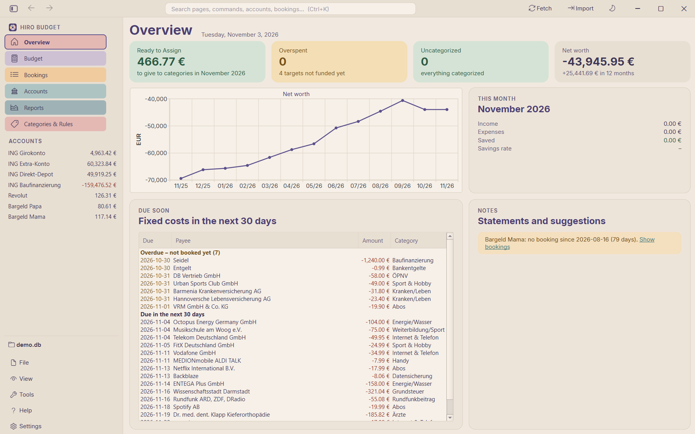
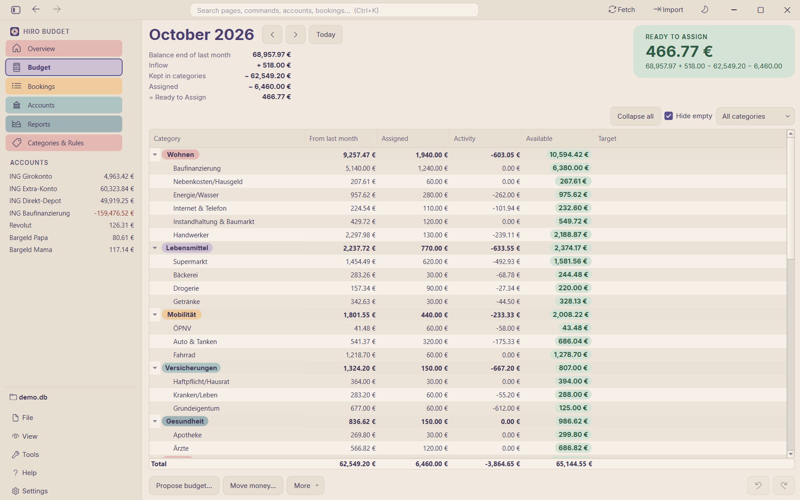
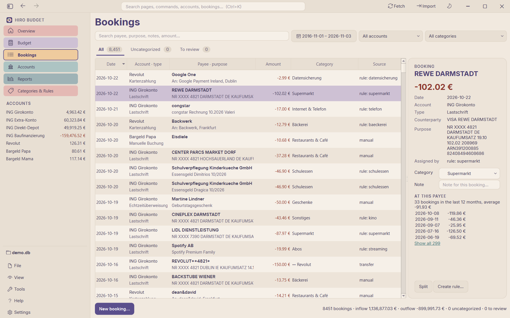
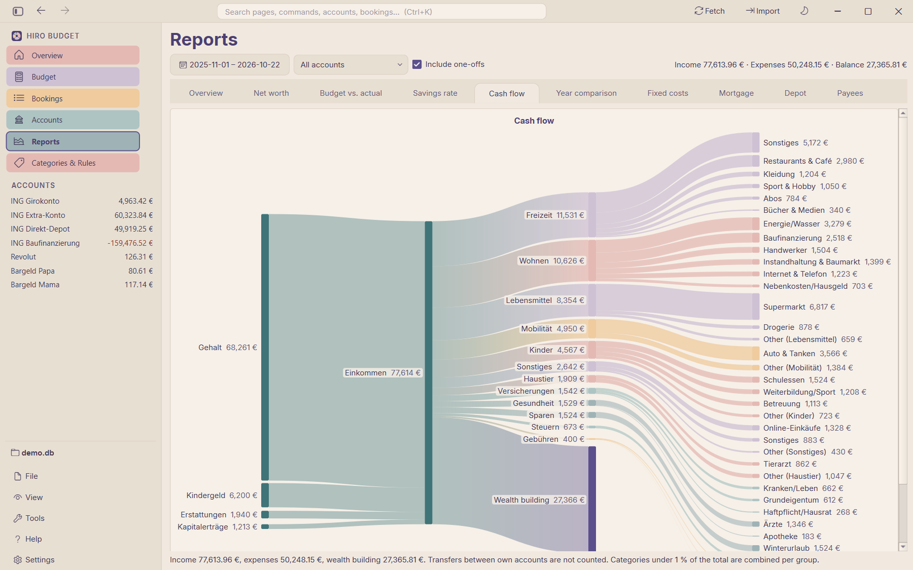

# Hiro Budget

A desktop app for a family's money, along the lines of "You Need A Budget": import your
bank statements, let the app categorize the bookings, give every euro a job, and see where
the money goes. **Everything stays on your computer**: no account, no cloud, no telemetry.



| Budget | Bookings | Cash flow |
|---|---|---|
|  |  |  |

The screenshots show the **demo**: ten years of a fictional family, generated by code.

## Try it

**Windows, without installing anything:** download `hiro-budget-<version>-windows.zip` from
the [releases](../../releases), unzip it to a folder you can write to (e.g. your Documents),
and

- double-click **`Start demo.cmd`** to look around in the demo (it starts fresh every time and
  never touches your data), or
- double-click **`hiro-budget.exe`** to start with your own data: on the first start it
  creates its configuration in `config/` next to it.

Windows may warn that the program is from an unknown publisher (it is not signed yet):
"More info" → "Run anyway".

**From source** (Windows; Linux/macOS untested), with [uv](https://docs.astral.sh/uv/):

```sh
git clone <this repository> && cd hiro-budget
uv sync
uv run hiro-budget demo     # the demo (generated on the first call, ~20 s)
uv run hiro-budget          # your own data
```

## What it imports

| Source | Files |
|---|---|
| ING (ING-DiBa) | Kontoauszug PDF (Giro, Extra-Konto), Umsatzanzeige PDF and CSV, Depotauszug PDF, mortgage statement PDF; current bookings also directly from the bank (FinTS) |
| Revolut | account statement PDF (German) and CSV (English) |
| PayPal | activity CSV; payments made from your bank account are linked to the bank booking instead of counted twice |
| **Your bank** | most banks export CSV: describe the columns once as a small format file ([guide](docs/csv-import.en.md)), or write an importer plugin ([guide](docs/plugins.md)); an AI assistant can help with both ([CSV](docs/csv-formats.llm.md), [plugins](docs/plugins.llm.md)) |

Importers for more banks are very welcome: see [CONTRIBUTING.md](CONTRIBUTING.md).

## How to use it

Month by month (import, first budget, monthly review, next month, analysis), with
screenshots of each step: [docs/workflows.en.md](docs/workflows.en.md), auf Deutsch
[docs/workflows.de.md](docs/workflows.de.md). The same guide is in the app under
"Help → User guide". The app speaks German and English.

## Features

- **Start page** (Übersicht): money to assign, overspent categories, bookings without a
  category, net worth over 12 months, this month's income and spending, fixed costs due
  in the next 30 days and missing statements; the key figures lead to their pages
- **Import** of ING (ING-DiBa) Kontoauszug PDFs (Girokonto, Extra-Konto incl. yearly
  statements), with a balance check (opening balance + bookings must equal the closing
  balance) and duplicate detection. **Missing statements** are reported: when a
  statement's opening balance differs from the previous closing balance, the import
  preview and the account's balance in the Accounts tab show a warning
- **Securities account** (Direkt-Depot): import of Depotauszug PDFs with the holdings
  (security, ISIN, quantity, price, value); the depot balance is the value of the latest
  Depotauszug (see below)
- **Mortgage loan** (Baufinanzierung): import of the (yearly) loan statement as balance
  statement (see below)
- **Revolut**: import of the EUR account statement PDF (German export, see below)
- **Umsatzanzeige**: import of the ING booking list PDF from online banking, e.g. for the
  current month before its Kontoauszug exists (see below)
- **CSV exports** in formats (plugins: built-in ones, own ones in `config/plugins/`; columns, encoding,
  account, duplicates by transaction ID, fingerprint or date and amount); included: the ING
  Umsatzanzeige CSV, the **Revolut** statement CSV (English export; bookings already
  imported from Revolut PDFs are recognised by date and amount) and **PayPal**. PayPal payments paid from the current account are not imported twice:
  the current account booking stays the expense and gets the PayPal payee and article
  ("Payment details", usable in rules); a payment whose bank booking is not imported yet
  waits and is linked after the next import or fetch. Adding a format for another bank:
  [docs/csv-import.en.md](docs/csv-import.en.md) (German: [csv-import.de.md](docs/csv-import.de.md));
  with the help of an AI assistant: [docs/csv-formats.llm.md](docs/csv-formats.llm.md)
- **Plugins**: every way bookings come in is a plugin, PDF and CSV importers as well as the
  online banking connection (FinTS), all through one interface (built-in ones in
  `src/hiro_budget/plugins/`, own ones in `config/plugins/`, listed under Settings →
  Plugins…; own plugins with program code run only when enabled there). Writing an importer
  or a bank connection for another bank:
  [docs/plugins.md](docs/plugins.md); with an AI assistant:
  [docs/plugins.llm.md](docs/plugins.llm.md); contributing it: [CONTRIBUTING.md](CONTRIBUTING.md)
- **Categorization**: transfers between own accounts, automatic mortgage split
  (interest vs. principal), YAML rules, and a local ML classifier for suggestions
- **Split bookings** over several categories
- **Reports** (one tab each, for the period and account chosen above):
  - *Overview*: income vs. expenses per month, fixed and variable costs per month,
    expenses by category (donut), category trend
  - *Net worth*: balance of all accounts at each month end (depot and loan from their
    statements), assets and debts
  - *Budget vs. actual*: assigned vs. spent per category and month
  - *Savings rate*: (income − expenses) / income per month and over 12 months
  - *Cash flow*: Sankey chart from the income categories through the income and expense
    groups to the expense categories, with the wealth building (surplus, or what came from reserves)
  - *Year comparison*: expenses per category of two years (January up to the same month)
  - *Fixed costs*: detected recurring payments (subscriptions, contracts, instalments)
    with their cost per month; ended ones in grey; a donut of fixed against variable costs per month
  - *Mortgage*: remaining debt, interest, repayment and special repayments per year
  - *Depot*: value per security on each depot statement vs. money invested
  - *Payees*: where the money goes; double-click shows the bookings
- **Accounts** tab: balances of all accounts, add accounts (e.g. cash), opening
  balances, transfer detection patterns; saved to `config.yaml`
- **Manual bookings** (expenses, income, transfers) on any account. Transfers to another
  own account create the counter-booking there automatically. When a bank statement is
  imported, its bookings replace matching manual entries (same amount, date within
  ±7 days) and keep their category and note. Right-click a transfer or its
  counter-booking to jump to the other side
- **View settings** (open tab, window size, column widths, budget filter and
  collapsed groups, …) are remembered in `ui_state.json` next to the database
- **Overlapping statements** are detected (stored bookings of the same account in the
  statement's period); you choose: add missing bookings, overwrite the period (manual
  categorizations and notes of identical bookings are kept), or cancel
- **Import history**: list imported files and delete an import (the file can then be
  imported again)
- **Notes** on bookings (searchable), **export** of bookings and reports to Excel or CSV
- **SQLite** database, **PySide6** GUI (German / English)

- **Budget** (YNAB style): give every euro a job (see below)

## Setup (from source)

Requires [uv](https://docs.astral.sh/uv/).

```sh
uv sync
uv run hiro-budget            # start the GUI
```

On first start, the folder `config/` with `config.yaml`, `categories.yaml` and
`rules.yaml` is created from the templates shipped with the app
(`src/hiro_budget/templates/`). Enter your own accounts and IBANs on the Accounts page
(or in `config/config.yaml` under `own_accounts`). If the configuration cannot be read, a
message box says why.

## Command line

```sh
uv run hiro-budget import input/            # import all PDFs and CSVs in a folder (or files)
uv run hiro-budget import new.pdf --on-overlap add   # add|overwrite|cancel; default: ask
uv run hiro-budget recategorize             # re-run categorization (manual edits are kept)
uv run hiro-budget train                    # retrain the ML classifier
uv run hiro-budget dump-pdf file.pdf --mask # a PDF's text as importers see it (for plugins)
uv run hiro-budget demo                    # the app on the demo (a fresh copy every time)
uv run hiro-budget --config-dir other/config  # use another configuration
```

## Configuration (YAML)

| File | Purpose |
|------|---------|
| `config/config.yaml` | database path, UI language, look (`theme`: system, light, dark or the warm "rose_pine" design (also as "rose_pine_dark"), set in the bundled Inter font, SIL Open Font License: `gui/fonts/`), own accounts (transfer detection), mortgage split, ML settings |
| `config/categories.yaml` | category groups and categories; `income: true` marks income groups |
| `config/rules.yaml` | categorization rules, first match wins |

Categories and rules can also be edited in the GUI ("Kategorien & Regeln"). Saving there
rewrites the edited section of the YAML file; comments at the top of the file are kept.

Example rule:

```yaml
- id: supermarkt
  category: lebensmittel.supermarkt
  match: {merchant: "(?i)rewe|aldi|lidl", amount_max: 0}
```

Match fields: `counterparty`, `merchant`, `purpose`, `booking_type`, `account`
(regular expressions), `amount_min` / `amount_max` (EUR, negative = outgoing).
All fields given must match.

## How categorization works

For each booking without a manual assignment:

1. **Transfer**: matches an own account's `match` patterns → excluded from reports. If
   the money leaves a budget account into a tracking account that has a
   `transfer_category` (e.g. ETF purchases into the depot), it is budgeted in that
   category
2. **Mortgage**: purpose contains `ZINSEN x TILGUNG y` → interest to the configured
   category, principal as a transfer to the loan account
3. **Rules** from `rules.yaml`
4. **ML suggestion** (TF-IDF + logistic regression, trained on rule and manual
   categorizations) if confidence ≥ `ml.min_confidence`. Shown as "Vorschlag"
   for review: "? Vorschläge prüfen (N)" on the Buchungen tab lists all of them;
   accept the selection (Enter) or all shown at once, or pick another category.
   Accepted bookings count as manual and train the classifier.
5. Otherwise **uncategorized**

Manual assignments (category, split, transfer) are never changed by automation and
are used to train the classifier.

## Securities account (Depot)

A Depotauszug lists the holdings on a date; importing it stores them as a *valuation*
(listed in the import history, deletable like any import). Before importing, the sum of
the positions is checked against the total value ("Gesamtkurswert").

- **Balance** of the depot = value of the latest Depotauszug + bookings after its date
  (e.g. later ETF purchases as transfer counter-bookings). A newer configured opening
  balance takes precedence.
- **Value per security**: on the Konten tab the depot row expands to one row per ISIN:
  value in the latest Depotauszug plus purchases minus sales since then, taken from the
  "WP-ABRECHNUNG … ISIN …" text of the bookings. Securities bought after the
  Depotauszug (e.g. a money market ETF) show up right away, at cost (marked "*"); the
  next Depotauszug brings the market value.
- **Holdings**: Konten tab → select the depot → "Bestände…" (one view per imported
  Depotauszug).
- A Depotauszug with the same date as a stored one replaces it.
- The depot is identified by its number ("Direkt-Depot Nr."), entered in the IBAN field
  of the account (`iban` in config.yaml).
- **Purchases and sales** are booked on the cash account (Extra-Konto or Girokonto) with
  `WP-ABRECHNUNG` in the purpose. The example config recognizes them as transfers to
  the depot (`match`) and budgets purchases from a budget account in
  `transfer_category` (Sparen: Wertpapiere). Sales flow into Zum Zuweisen.
- Distributions and interest (`Zins/Dividende`, `Zinsertrag`) go to Einkommen:
  Kapitalerträge, withholding tax and solidarity surcharge to Steuern:
  Kapitalertragsteuer (example rules).

Example (config.yaml):

```yaml
  - name: ING Direkt-Depot
    kind: depot
    institution: ING
    iban: "1234567890"          # depot number
    match: {purpose: "(?i)WP-ABRECHNUNG"}
    transfer_category: sparen.wertpapiere
```

## Mortgage loan (Baufinanzierung)

The payments are booked on the Girokonto and split there into interest (expense) and
principal (transfer to the loan account, see "How categorization works"). The loan's own
statement contains the same payments again, so it is imported as a **balance statement**:

- Its closing balance ("Neuer Saldo") on the end of the statement period becomes the
  loan balance; principal transfers after that date are added. A newer configured
  opening balance takes precedence, so remove `opening_balance` once a statement is
  imported.
- Its bookings (Zinsen, Lastschrifteinzug, Auszahlung, ...) are checked against the
  opening and closing balance and shown in the import preview, but not stored.
- The loan account is identified by the IBAN of the statement (`iban` in config.yaml).

## ING Umsatzanzeige

The booking list exported in ING online banking (Umsätze → PDF) covers any period, so
the current month can be imported before its Kontoauszug exists.

- It has no opening balance; it is derived from the oldest booking's balance. Every
  booking is checked against the running balance, and the number of bookings against
  the header.
- Pending bookings (vorgemerkte Umsätze) are not included.
- Booking texts are mapped to the Kontoauszug spelling (e.g. "Dauerauftrag /
  Terminueberweisung" → "Dauerauftrag/Terminueberw.").
- The purposes lack the Mandat/Referenz lines. When the Kontoauszug of the period is
  imported later, choose **overwrite**: its bookings replace these ones, and manual
  categorizations and notes of identical bookings are kept.

## Revolut

Export the statement in the Revolut app as PDF in German (Konto → Kontoauszug, EUR,
any period; overlapping exports are fine, already stored bookings are skipped).

- An export may contain several sections (Revolut Payments UAB, Revolut Bank UAB, its
  German branch). Each section's bookings are checked against its running balance and
  its summary; the move of the balance from one Revolut entity to the next is skipped.
- Reversed transactions ("Rückgängig gemacht") are not imported.
- Card payments get the shop as payee; exchange rate and fee stay in the purpose.
- The account is identified by the (German) IBAN in the statement header. Top-ups
  from another own account are transfers when matched, e.g.

```yaml
  - name: Revolut
    kind: giro
    institution: Revolut
    iban: DE00 0000 0000 0000 0000 00
    # top-ups as seen on the Girokonto ("VISA REVOLUT**1234*")
    match: {counterparty: "(?i)revolut"}
```

## Budget (YNAB principles)

The **Budget** tab shows one month at a time:

| Column | Meaning |
|--------|---------|
| Zugewiesen | money you give a job this month (double-click: `600`, `+50`, `-20`, `=0`) |
| Aktivität | bookings of the category in this month (double-click shows them) |
| Verfügbar | carried over + assigned + activity; red = overspent, yellow = target not funded |
| Ziel | target and what is still needed this month (double-click to edit) |

- **Zum Zuweisen (Ready to Assign)**: money on budget accounts that has no job yet.
  Income (categories of the income group) and uncategorized bookings flow in here.
  Give every euro a job until it is 0; negative means you assigned more than you have.
- **Budget accounts**: giro, savings, cash and credit card by default; loans and
  securities accounts are tracking accounts (balance only). Change it per account in
  the Konten tab ("Budgetkonto").
- **Money leaving the budget** to a tracking account needs a category, e.g. the mortgage
  principal (`principal_category` in config.yaml). The example puts interest and
  principal into one category "Wohnen: Baufinanzierung": one budget line for the whole
  payment, while reports still count only the interest as expense.
- **Overspending** (negative Verfügbar) is not carried into the next month; it is taken
  from the next month's Zum Zuweisen. Cover it with "Geld verschieben" (rule 3: roll
  with the punches).
- **Targets** (rule 2: embrace your true expenses), stored in categories.yaml:
  monthly amount, amount by date, repeating (e.g. yearly insurance), savings balance.
  "Ziele zuweisen" funds what the targets need this month as far as money allows.
- **Group budgets**: right-click a group → "Gruppe als Ganzes budgetieren" (or
  `budget: group` on the group in categories.yaml). The group becomes one envelope:
  assigned, available, target and proposal belong to the group, and its categories
  share the money and only show their activity (categorization and reports are
  unchanged). Switching adds the categories' assigned amounts up into the group (all
  months), so Zum Zuweisen stays the same; switching back puts the group amount on the
  first category and removes the group target.
- **Vormonat übernehmen** copies last month's amounts into empty categories.
- **Budget vorschlagen** proposes amounts from past spending: regular categories
  (spending in at least two thirds of the months) get the median of the last 6 months,
  so one-off purchases don't inflate them; irregular ones (insurance, gifts, repairs)
  get the total of the last 12 months spread as monthly provision. Proposals are rounded
  up to 10 € and can be edited and selected before applying (`budget.proposal_months`,
  `budget.proposal_round_to` in config.yaml).
- **Start month**: `budget.start_month` in config.yaml (default: first month with
  bookings). Everything before counts as starting balance.

The budget keeps this invariant: balance of all budget accounts = Zum Zuweisen + sum
of Verfügbar.

## Backups

Before every import (GUI and command line) the database and the configuration
(config/categories/rules.yaml) are copied to `data/backups/<date>_<time>_import/`; the
newest 10 are kept (`backup.keep`, off with `backup.before_import: false`). *File →
Create backup* makes one by hand, *File → Open backup folder* shows them. To restore,
close the app and copy the files of a backup back (the database into `data/`, the YAML
files into `config/`).

To keep the data in a cloud or NAS folder, *Settings → Data folder…* moves the database,
the classifier, the backups and the view settings there together (setting `data_folder` in
`config.yaml`) and restarts the app on it.

## Log file

The app writes warnings and errors, with their tracebacks, to `data/logs/hiro-budget.log`
(in the data folder; 1 MB, the three previous files are kept). *Help → Open log folder*
shows it; attach it to a bug report. Bank texts are not logged at this level.

## Privacy

Statements and the database contain personal data. `input/`, `data/`, `*.db`, the
classifier model and your local `config/*.yaml` are git-ignored; only the example
configuration is committed.

## Development

```sh
uv run pytest                 # tests (GUI tests run headless)
uv run ruff check src tests   # lint
uv run ruff format src tests  # format
uv run mypy                   # type check of services, importers, db, config
```

- Tests use synthetic statement data (`tests/fixtures`) and a generated PDF. If real
  statements are present in `input/`, an extra test checks that they all balance.
- Schema changes: edit `src/hiro_budget/db/models.py`, then
  `uv run alembic revision --autogenerate -m "..."`. The app migrates the database
  on startup.
- Translations: after changing UI strings, run
  `uv run pyside6-lupdate src/hiro_budget/gui/*.py src/hiro_budget/gui/models/*.py src/hiro_budget/gui/reports/*.py -ts src/hiro_budget/i18n/app_de.ts src/hiro_budget/i18n/app_en.ts`,
  translate with `uv run pyside6-linguist src/hiro_budget/i18n/app_de.ts`, then
  `uv run pyside6-lrelease src/hiro_budget/i18n/app_de.ts src/hiro_budget/i18n/app_en.ts`.
- Screenshots come from the demo (`uv run hiro-budget demo`), never from real data. Look at
  each image before committing it.
- New statement sources (other banks, broker, mortgage): a plugin, a folder with
  `plugin.yaml` and a CSV format or an importer ([docs/plugins.md](docs/plugins.md); the
  built-in ones are in `src/hiro_budget/plugins/`). A source that lists holdings instead of bookings returns a statement with
  `valuation=True` and `holdings` (see `plugins/ing_depot_pdf/importer.py`).

## Project layout

```
config/                         your YAML configuration (created from the templates)
src/hiro_budget/
  importers/                    importing: data types, plugin loader, CSV engine, connectors
  plugins/                      built-in importers (ING, Revolut, PayPal) and FinTS, one folder each
  services/                     import, categorization pipeline, budget, reports, edits
  db/                           SQLAlchemy models + Alembic migrations
  gui/                          PySide6 views
  i18n/                         Qt translations
  templates/                    example configuration
demo/                           demo generator and its configuration
docs/                           user guide (en, de), CSV and plugin guides, screenshots
packaging/                      Windows build (Nuitka) and release zip
tests/
```
