# Arbeiten mit der App: Abläufe

*English: [workflows.en.md](workflows.en.md)*

So nutzt du Hiro Budget Monat für Monat: Kontoauszüge importieren, Buchungen
aufräumen, das erste Budget anlegen, den Vormonat prüfen, den nächsten Monat planen und
auswerten, wohin das Geld geht. Beschriftungen stehen so in Anführungszeichen, wie die App
sie zeigt (Sprache Deutsch, „Einstellungen → Sprache“).

Das Budget folgt den YNAB-Regeln: **Jeder Euro bekommt eine Aufgabe** („Zum Zuweisen“ geht
auf 0), **echte Ausgaben einplanen** (Ziele für jährliche und unregelmäßige Kosten),
**flexibel bleiben** (Überziehungen durch Verschieben ausgleichen), **das Geld altern
lassen** (das Einkommen des Vormonats ausgeben).

Seiten (Seitenleiste, `Strg+1` … `Strg+6`): **Übersicht**, **Budget**, **Buchungen**,
**Konten**, **Berichte**, **Kategorien & Regeln**. `Strg+K` durchsucht Seiten, Befehle,
Konten und Buchungen; `F1` zeigt alle Tastenkürzel. Diese Anleitung steht auch in der App:
„Hilfe → Anleitung“.

---

## 0. Einmalig: einrichten

1. **Konten**: jedes eigene Konto mit seiner IBAN (Depot: die Depotnummer), damit Importe
   beim richtigen Konto landen. Für Umbuchungen zwischen eigenen Konten macht „Umbuchungen
   auf dieses Konto erkennen“ (Muster auf Gegenpartei oder Verwendungszweck, z. B. „VISA
   REVOLUT“ für Revolut-Aufladungen vom Girokonto) daraus Umbuchungen statt Ausgaben.
   Bargeld: „Neues Konto“, Art Bargeld, Anfangssaldo. „Budget: Geld wird Kategorien
   zugewiesen“ legt fest, mit welchen Konten das Budget plant (standardmäßig Giro-,
   Spar- und Bargeldkonten; Depot und Kredit führen nur einen Saldo).
   Reihenfolge: ein Konto nach oben oder unten ziehen oder ↑ / ↓ (Alt+↑ / Alt+↓), dann
   „Konten speichern“; die Seitenleiste zeigt dieselbe Reihenfolge. Ein Klick auf einen
   Spaltenkopf sortiert nur die Ansicht (erneut: absteigend, ein drittes Mal: wieder deine
   Reihenfolge).

   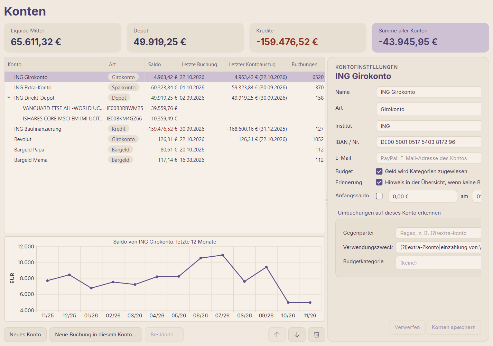
2. **Kategorien** („Kategorien & Regeln“): Gruppen und Kategorien so, wie du budgetieren
   willst. Wenige und aussagekräftige sind besser als viele. „Einmalig“ ankreuzen für
   unregelmäßige Einnahmen und Ausgaben (Bonus, Steuererstattung, Reparaturen), die die
   Berichte weglassen können sollen; siehe „Einmaliges und Berichtsmonat“ in 5.
3. **Regeln** (gleiche Seite): wiederkehrende Empfänger → Kategorie, der erste Treffer
   gewinnt. Die meisten Regeln entstehen später schnell aus den Buchungen selbst (siehe
   1.3). Die Felder nehmen reguläre Ausdrücke; das „?“ im Feld (oder dort `F1`, oder „Hilfe
   → Regex-Spickzettel…“) zeigt die Syntax und Beispiele wie `(?i)rewe|edeka|aldi`. Die Zahl
   hinter jeder Regel sagt, wie viele Buchungen sie kategorisiert; grau = keine (veraltet,
   oder eine Regel weiter oben nimmt alle Treffer). Das Suchfeld über der Liste filtert nach
   ID, Kategorie und Muster; „Buchungen anzeigen“ unter einer Regel zeigt ihre Treffer.

   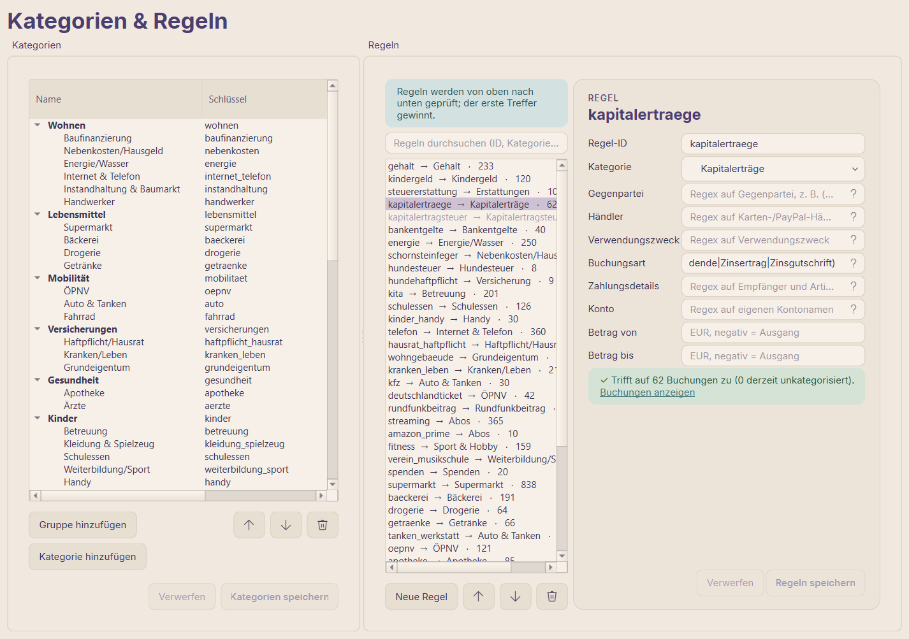
4. **Import-Ordner**: `import_folder` in `config/config.yaml` (Standard `input/`). Neue PDFs
   und CSVs dort lassen einen Punkt auf „Importieren“ in der Titelleiste erscheinen.
5. **Budgetbeginn** (optional): `budget.start_month`; standardmäßig der erste Monat mit
   Buchungen. Alles davor zählt als Anfangsbestand.
6. **PayPal** (optional): „Neues Konto“, Art „Bezahldienst (PayPal)“, „E-Mail“ = die
   Adresse des PayPal-Kontos, „Konten speichern“. Ein Konto je PayPal-Konto.

---

## 1. Kontoauszüge importieren (nach jedem Monat oder wenn neue Auszüge da sind)

### 1.1 Dateien besorgen

| Quelle | Was herunterladen | Wie oft |
|---|---|---|
| ING Girokonto, Extra-Konto | Kontoauszug als PDF (Postbox) | monatlich |
| ING, laufender Monat | Umsatzanzeige als PDF (Umsätze → PDF) — für Buchungen, bevor es den Kontoauszug gibt | bei Bedarf |
| Revolut | Kontoauszug als PDF, EUR, auf Deutsch, oder als CSV auf Englisch (beliebiger Zeitraum; Überschneidungen sind kein Problem, auch zwischen PDF und CSV) | monatlich |
| ING Direkt-Depot | Depotauszug als PDF (Bestände und Kurswerte) | vierteljährlich / sobald er kommt |
| ING Baufinanzierung | jährlicher Kreditauszug (setzt den Kreditsaldo) | jährlich |
| ING, beliebiger Zeitraum | Umsatzanzeige als CSV (Umsätze → CSV) — dieselben Buchungen wie das PDF, eins von beiden | bei Bedarf |
| PayPal | Aktivitäten als CSV herunterladen, alle Transaktionen (beliebiger Zeitraum; Überschneidungen sind kein Problem) | monatlich |

Leg sie in den Import-Ordner (oder irgendwohin).

### 1.2 Importieren

1. „Importieren“ in der Titelleiste (Punkt = neue Dateien im Import-Ordner) oder `Strg+I`.
   Die neuen Dateien aus dem Import-Ordner stehen schon in der Liste; weitere über „Dateien
   hinzufügen…“ / „Ordner hinzufügen…“.
2. Vor dem Import die Liste prüfen:
   - **Saldo ✓**: Anfangssaldo + Buchungen = Endsaldo. Fehlt das ✓, wurde die Datei nicht
     richtig gelesen: nicht importieren.
   - **Status**: „bereit“; „nichts Neues“ / „bereits importiert“ (wird übersprungen);
     „Auszüge fehlen, siehe unten“ (zwischen dem letzten Import und diesem fehlt ein
     Kontoauszug — ihn auch importieren, sonst stimmt der Saldo nicht); „überschneidet …
     gespeicherte Buchungen – Sie werden gefragt“ (siehe unten).
   - Die untere Tabelle zeigt die Buchungen der gewählten Datei mit der Kategorie, die sie
     bekommen werden („Kategorie (Vorschau)“). „neu, ersetzt manuelle Buchung“ heißt: Eine
     von Hand erfasste Buchung wird durch die importierte ersetzt (Kategorie und Notiz
     bleiben).

   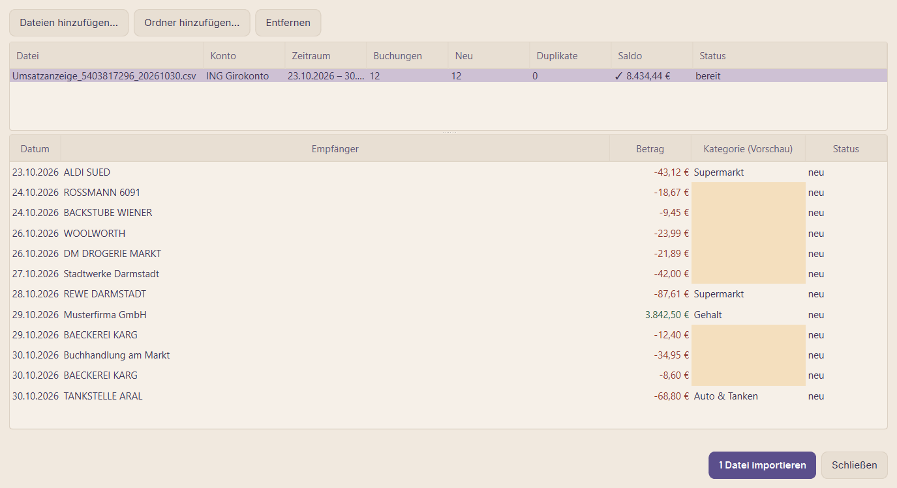
3. „N Dateien importieren“. Vor dem Import werden Datenbank und Konfiguration automatisch
   gesichert. Danach lernt der Klassifikator aus den kategorisierten Buchungen („Der
   Klassifikator lernt aus den kategorisierten Buchungen…“, 1–3 s).
4. **Überlappende Kontoauszüge** (z. B. der Kontoauszug nach einer Umsatzanzeige desselben
   Monats): „Fehlende ergänzen“ importiert nur Buchungen, die noch nicht gespeichert sind;
   „Überschreiben“ ersetzt den Zeitraum durch die Datei (das ist die richtige Wahl, wenn der
   Kontoauszug auf eine Umsatzanzeige folgt; Kategorien und Notizen gleicher Buchungen
   bleiben erhalten).

Etwas schiefgegangen? „Datei → Importverlauf…“ listet jeden Import; wird einer gelöscht,
verschwinden seine Buchungen und die Datei lässt sich erneut importieren.

### 1.2b Stattdessen von der Bank abrufen (FinTS)

Konten mit Onlinebanking (ING) lassen sich abrufen, statt Kontoauszüge herunterzuladen.

1. **Einmal:** „Einstellungen → Bankzugänge…“. Den Anmeldenamen eintragen (Bankleitzahl
   und Server der ING sind vorbelegt), „Verbindung testen…“ (fragt die PIN ab) listet die
   Konten des Zugangs. Für jedes das **App-Konto** wählen (ein vorhandenes mit derselben
   IBAN ist vorausgewählt, sonst „Neu: …“) und **„Abruf ab“** prüfen: Buchungen ab diesem
   Tag kommen von der Bank, Kontoauszüge decken die Tage davor ab. Vorbelegt ist der Tag
   nach dem letzten importierten Kontoauszug des Kontos; bei neuen Konten „so weit wie
   möglich“ (ihr Anfangssaldo kommt dann von der Bank). „Speichern“. Die PIN wird nicht
   gespeichert.
2. **Jedes Mal:** „Abrufen“ in der Titelleiste (oder „Datei → Von der Bank abrufen“), PIN
   eingeben. Der Status neben der Schaltfläche zeigt „Abruf bei ING…“, „Bitte in der
   ING-App bestätigen“ mit „Abbrechen“, wenn die Bank eine Bestätigung will, und am Ende
   „✓ N neue Buchungen · Salden stimmen“. „⚠ … Saldo weicht ab“: Ein Klick auf den Status
   zeigt die Einzelheiten (Saldo bei der Bank und in der App je Konto).
3. Neue Buchungen werden kategorisiert wie importierte. Jeder Abruf steht unter „Datei →
   Importverlauf…“ (ein Eintrag je Konto mit neuen Buchungen) und lässt sich dort löschen;
   der nächste Abruf holt diese Buchungen erneut.
4. Kontoauszüge eines abgerufenen Kontos lassen sich weiter importieren: Buchungen an schon
   abgerufenen Tagen werden ausgelassen („… per FinTS“ in der Importliste), alle anderen
   importiert. Ein späterer Abruf ersetzt Auszugsbuchungen, die er selbst liefert (Kategorie
   und Notiz bleiben).

Depots werden aufgelistet, ihre Bestände aber noch nicht abgerufen.

### 1.2c CSV-Exporte und PayPal

CSV-Dateien werden wie PDFs importiert. Welche Spalte was bedeutet, steht je Bank in einem
Format (dabei: ING-Umsatzanzeige, Revolut und PayPal); ein Format für den Export einer anderen
Bank ist ein kleines Plugin in `config/plugins/`, siehe [csv-import.de.md](csv-import.de.md).

PayPal: die meisten Zahlungen laufen über das Girokonto (Debitkarte oder Lastschrift), dort
stehen sie also schon als „VISA PAYPAL *…“ oder „PayPal Europe“. Sie werden nicht ein
zweites Mal importiert: die Buchung auf dem Girokonto bleibt die Ausgabe und bekommt den
Empfänger und Artikel von PayPal („Zahlungsdetails“ in den Buchungsdetails; Regeln können
darauf prüfen, Feld „Zahlungsdetails“). Die Importliste zeigt sie als „N Zahlungen über die
Bank“. Nur was das Girokonto nicht berührt, wird eine Buchung des PayPal-Kontos: Zahlungen
aus dem PayPal-Guthaben, erhaltenes oder gesendetes Geld.

Das Girokonto bucht eine PayPal-Zahlung einige Tage später. Ist sie dort noch nicht
importiert, wartet die Zahlung und wird nach dem nächsten Import oder Abruf verknüpft; die
Meldung nach dem Import sagt, wie viele warten (und wie viele seit mehr als 30 Tagen: die
kamen wahrscheinlich von einem anderen Konto).

### 1.3 Die neuen Buchungen aufräumen

Ziel: Jede Buchung hat eine Kategorie. Die Übersicht zeigt, was noch offen ist („Buchungen
ohne Kategorie“, „Vorschläge zu prüfen“); die Budgetseite warnt mit einem Hinweis („Jetzt
kategorisieren“).

1. **Vorschläge des Klassifikators**: „Buchungen“ → „? Zu prüfende Vorschläge“. Falsche
   korrigieren (`Enter`/`F2` auf der Zeile oder das Kategoriefeld in der Karte rechts),
   dann „Auswahl bestätigen“ oder „Alle angezeigten bestätigen (N)“. Bestätigte Vorschläge
   zählen als manuell und verbessern den Klassifikator.

   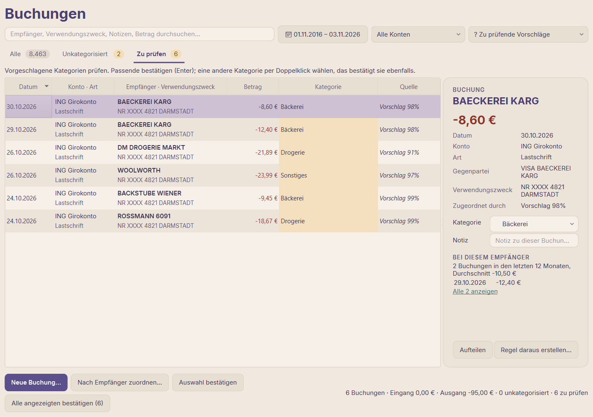
2. **Unkategorisierte nach Empfänger**: „⚠ Unkategorisiert“ → „Nach Empfänger
   zuordnen…“. Ein Empfänger nach dem anderen mit allen seinen Buchungen; Kategorie wählen,
   „Regel anlegen: künftige Buchungen von … bekommen diese Kategorie“ ankreuzen, damit
   künftige Buchungen automatisch kategorisiert werden, „Zuordnen“. Damit ist der größte
   Teil der Liste schnell erledigt.

   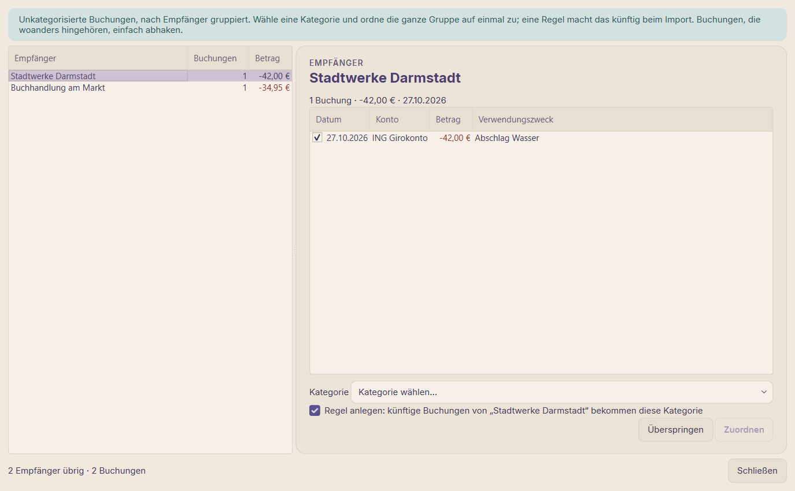
3. **Der Rest von Hand**: Buchung wählen, `Enter`/`F2` oder Doppelklick auf ihre Kategorie:
   ein Menü mit einem Untermenü je Gruppe (die aktuelle Kategorie ist abgehakt); oder die
   Karte rechts.
   - Eine Zahlung für mehreres (Supermarkt + Drogerie, eine gemischte Online-Bestellung):
     „Aufteilen“ in der Karte rechts (oder `Strg+D`, oder Rechtsklick → „Aufteilen…“): je
     Teil eine Zeile mit Kategorie oder Umbuchung, Betrag und Notiz; „Rest“ muss 0,00 sein,
     dann „Aufteilung speichern“. Eine aufgeteilte Buchung zeigt dort ihre Teile, sie bleiben
     änderbar; mit nur noch einem Teil ist sie wieder eine normale Buchung.

     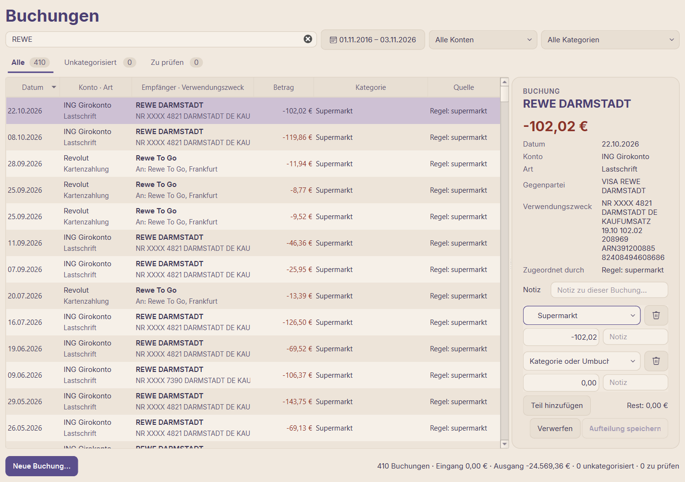
   - Wiederkehrender Empfänger ohne Regel: Rechtsklick → „Regel aus dieser Buchung
     erstellen…“; der Regel-Editor zeigt, wie viele Buchungen die Regel treffen würde.
   - Was man sich merken sollte („Geschenk für Oma“, „Rückzahlung folgt“): „Notiz“ in der
     Karte; Notizen sind durchsuchbar.
   - Ist das viel? „Bei diesem Empfänger“ in der Karte: Anzahl und Durchschnitt der letzten
     12 Monate, die letzten Buchungen, „Betrag geändert: vorher …“ bei einer neuen Höhe,
     „Alle N anzeigen“.
4. **Bargeld und andere manuelle Buchungen**: „Neue Buchung…“ (`Strg+N`) — Ausgabe,
   Einnahme oder Umbuchung auf einem beliebigen Konto (z. B. abgehobenes Bargeld, auf dem
   Markt ausgegeben). Eine Umbuchung auf ein anderes eigenes Konto legt dort die
   Gegenbuchung an.
5. Fertig, wenn „Unkategorisiert“ und „Zu prüfen“ 0 zeigen.

---

## 2. Das erste Budget anlegen

Voraussetzung: Ein paar Monate Historie sind importiert (3–6 Monate ergeben gute
Vorschläge; der Vorschlagsdialog warnt bei zu wenig Historie) und die Buchungen sind
kategorisiert (Schritt 1.3).

1. Seite **Budget**, der aktuelle Monat („Heute“). Oben: „Zum Zuweisen“ — das Geld auf den
   Budgetkonten, das noch keine Aufgabe hat.

   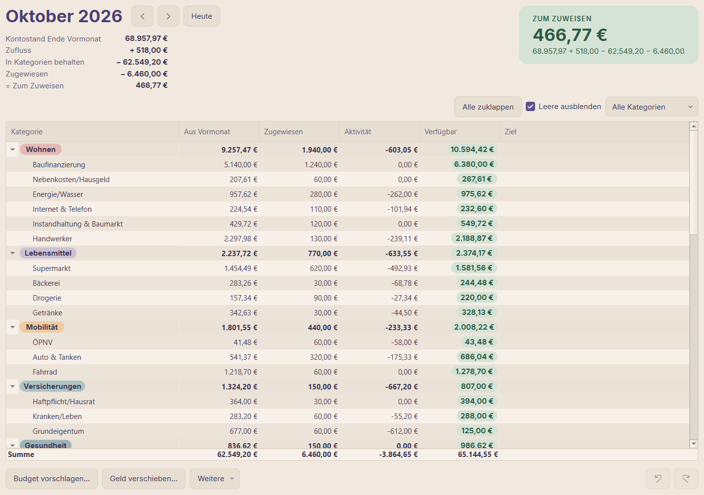
2. **„Budget vorschlagen…“** schlägt je Kategorie einen Betrag aus den bisherigen Ausgaben
   vor.
   - „regelmäßig“ (Ausgaben in den meisten Monaten): der Median der letzten Monate, damit
     einmalige Käufe ihn nicht aufblähen.
   - „unregelmäßig (Rücklage)“: Versicherungen, Geschenke, Reparaturen — die Summe der
     letzten 12 Monate, als monatliche Rücklage verteilt.
   - Min / Median / Max anklicken, um einen anderen Wert zu übernehmen; Kategorien
     abwählen, die du selbst festlegen willst; „Nur leere Kategorien“ lässt bereits
     Zugewiesenes stehen. Unten steht, was danach noch zuzuweisen ist. „Auswahl
     übernehmen“.

   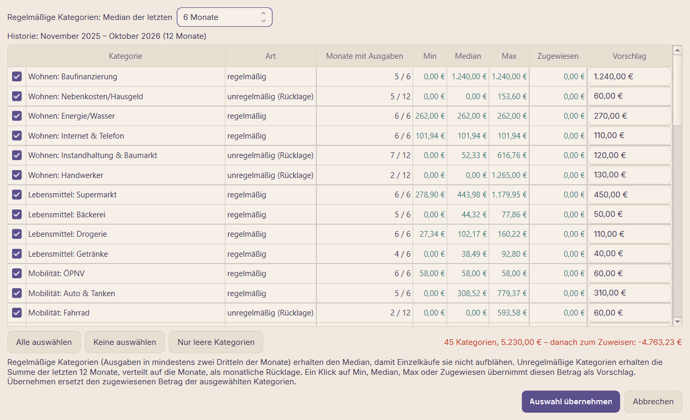
3. **Anpassen** je Kategorie in „Zugewiesen“: Doppelklick oder `Enter`, dann `600`, `+50`,
   `-20` oder `=0` eintippen. Alles lässt sich rückgängig machen (`Strg+Z` / `Strg+Y`).
4. **Ziele** für echte Ausgaben (Spalte „Ziel“, Doppelklick):
   - „Monatlicher Betrag“: z. B. Taschengeld, ein Sparplan
   - „Betrag bis Datum“: z. B. Urlaub 2.400 € bis Juli; die App rechnet den Monatsbetrag aus
   - „Wiederkehrend (z. B. jährlich)“: Kfz-Versicherung alle 12 Monate, fällig im Januar
   - „Sparguthaben“: ein Notgroschen, der erreicht werden soll, ohne Termin

   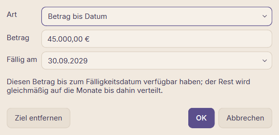

   Danach finanziert „Weitere ▾ → Ziele zuweisen“, was die Ziele in diesem Monat brauchen,
   soweit das Geld reicht. Gelbes „Verfügbar“ = Ziel noch nicht finanziert. Der Balken unter
   jedem Ziel zeigt, wie weit es ist: grün im Plan, gelb, solange diesem Monat noch Geld fehlt.
5. **„Zum Zuweisen“ auf 0 bringen**: positiv — dem Rest eine Aufgabe geben (Sparziel,
   Puffer, nächste große Ausgabe); negativ — es ist mehr zugewiesen als vorhanden, Geld aus
   Kategorien zurücknehmen („Zu viel zugewiesen – aus Kategorien zurücknehmen“).
6. Optional: eine Gruppe, deren Kategorien sich das Geld teilen dürfen (z. B. Freizeit):
   Rechtsklick auf die Gruppe → „Gruppe als Ganzes budgetieren“.

Die Regel dahinter: Saldo aller Budgetkonten = Zum Zuweisen + Summe von „Verfügbar“. Die
Zusammenfassung unter dem Monat zeigt, wie „Zum Zuweisen“ zustande kommt: „Kontostand Ende
Vormonat“ + „Zufluss“ − „In Kategorien behalten“ (was die Kategorien aus dem Vormonat
mitbringen) − „Zugewiesen“.

---

## 3. Den Vormonat prüfen (Anfang des neuen Monats)

Zuerst Schritt 1, damit alle Buchungen des Monats da und kategorisiert sind.

1. **Budget** → Vormonat (`Alt+Bild↑` oder der Pfeil neben dem Monat).
2. **Überzogene** Kategorien (rotes „Verfügbar“): Überziehungen werden nicht übertragen,
   sie werden vom „Zum Zuweisen“ des nächsten Monats abgezogen. Jetzt ausgleichen:
   - die rote Zeile wählen → „Geld verschieben…“ (`Strg+M`) aus einer Kategorie, in der
     Geld übrig ist, oder
   - „Weitere ▾ → Überziehungen ausgleichen“ gleicht alle aus „Zum Zuweisen“ aus, soweit
     möglich.

   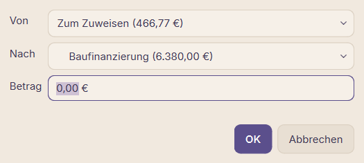
3. **Abweichungen verstehen**: Doppelklick auf „Aktivität“ einer Kategorie zeigt ihre
   Buchungen des Monats. Falsche Kategorie? Dort korrigieren (die Buchung wandert in den
   richtigen Topf). Eine unerwartete Einmalausgabe? Notieren; vielleicht braucht sie ab
   jetzt ein Ziel.
4. **Soll/Ist** („Berichte → Soll/Ist“, Zeitraum = dieser Monat oder die letzten Monate):
   zugewiesen und ausgegeben je Kategorie. Kategorien, die immer drüber oder immer weit
   darunter liegen, sind die, die im nächsten Budget korrigiert werden.
5. **Übrig gebliebenes Geld** bleibt in seiner Kategorie („Aus Vormonat“ im nächsten Monat);
   genau dafür sind Rücklagen da. Für Kategorien, die jeden Monat neu anfangen sollen, den
   Rest mit „Geld verschieben…“ in ein Sparziel oder zurück nach „Zum Zuweisen“ schieben.
6. **Den Plan anpassen**: Beträge oder Ziele ändern, die sich als falsch erwiesen haben
   (Schritte 2.3 / 2.4). Zuweisungen eines vergangenen Monats zu ändern ist erlaubt; es
   ändert, was übertragen wurde.

---

## 4. Budget für den kommenden Monat

Am besten, wenn das Gehalt eingegangen ist (Einnahmen fließen in „Zum Zuweisen“ des Monats,
in dem sie gebucht sind), oder vorab mit dem Geld, das schon da ist.

1. **Budget** → nächster Monat (`Alt+Bild↓`).
2. Ein Ausgangspunkt, eins davon:
   - „Weitere ▾ → Vormonat übernehmen“: die Beträge des Vormonats in leere Kategorien
     (ruhige Monate)
   - „Budget vorschlagen…“: neue Vorschläge aus der Historie (nach Veränderungen: neue
     Stelle, Kinderbetreuung, neues Auto)
   - danach „Weitere ▾ → Ziele zuweisen“ für die Ziele.
3. **Besonderes in diesem Monat**: Geburtstage, Urlaub, Schulanfang, jährliche
   Versicherungen. Die Übersicht zeigt „Demnächst fällig“ (Fixkosten der nächsten 30 Tage),
   „Berichte → Fixkosten“ alle wiederkehrenden Zahlungen mit ihren Monaten; darauf achten,
   dass ihre Kategorien genug haben.
4. **„Zum Zuweisen“ auf 0** wie in Schritt 2.5. „In späteren Monaten zugewiesen“ in der
   Zusammenfassung zeigt Geld, das bereits späteren Monaten gegeben wurde (vorausplanen ist
   in Ordnung; es wird von „Zum Zuweisen“ abgezogen).
5. Während des Monats: Ausgaben erscheinen nach jedem Import als „Aktivität“. Geht einer
   Kategorie das Geld aus, rechtzeitig (oder gleich danach) aus einer anderen nachschieben:
   „Geld verschieben…“.

---

## 5. Auswertung

### Kurzer Blick jeden Monat: Übersicht

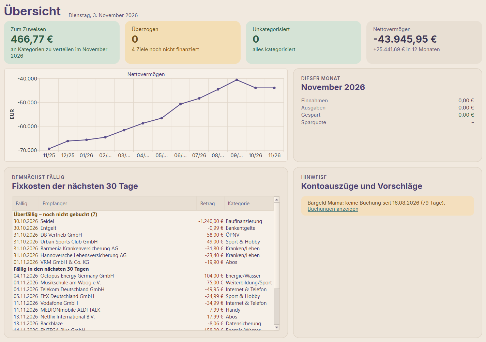

| Karte / Bereich | Frage | Nächster Schritt |
|---|---|---|
| Zum Zuweisen | Hat jeder Euro eine Aufgabe? | anklicken → Budget |
| Überzogen | Welche Kategorien sind überzogen? | anklicken → Budget, ausgleichen (3.2) |
| Unkategorisiert / Vorschläge | Ist alles kategorisiert? | anklicken → Buchungen (1.3) |
| Nettovermögen | Wie hat sich das Vermögen in 12 Monaten entwickelt? | anklicken → Berichte → Vermögen |
| Dieser Monat | Einnahmen, Ausgaben, gespart, Sparquote bisher | — |
| Demnächst fällig | Welche Fixkosten kommen in den nächsten 30 Tagen? | ihre Budgetkategorien prüfen |
| Hinweise | Fehlende Kontoauszüge, Konten ohne Buchung seit Wochen (Bargeld zählen?), zu prüfende Vorschläge | die fehlenden Auszüge importieren; die Erinnerung je Konto unter „Konten“ abschalten |

### Berichte

Oben den **Zeitraum** (Schaltfläche mit Vorgaben: Dieser Monat, Letzter Monat, Dieses Jahr,
Letztes Jahr, Letzte 12 Monate, Alles oder eigene Daten) und das **Konto** wählen; alle
Reiter folgen dieser Auswahl. „Datei → Exportieren → Bericht (aktueller Zeitraum)…“
speichert nach Excel/CSV.

| Reiter | Welche Frage er beantwortet | Typischer Einsatz |
|---|---|---|
| Übersicht | Einnahmen und Ausgaben je Monat; darunter die Ausgaben je Monat als fixe und variable Kosten; Ausgaben nach Gruppe als Ring (ein Klick auf eine Gruppe zeigt ihre Kategorien, „← Alle Gruppen“ zurück; Doppelklick auf eine Kategorie: ihre Buchungen); wie sich eine Kategorie entwickelt (Kategorie-Verlauf) | monatlich; eine Kategorie wählen, um ihren Verlauf zu sehen |
| Vermögen | Vermögen zu jedem Monatsende: Konten, Depot, abzüglich Kredit | vierteljährlich / jährlich |
| Soll/Ist | Zugewiesen und ausgegeben je Kategorie und Monat | nach jedem Monat (3.4); Korrekturen planen |
| Sparquote | (Einnahmen − Ausgaben) / Einnahmen je Monat und über 12 Monate | Monatsverlauf, Jahresziel |
| Geldfluss | Wohin das Geld fließt: Einnahme-Kategorien → Einnahme-Gruppen → Ausgabe-Gruppen → Ausgabe-Kategorien (Sankey), mit dem Vermögensaufbau (Überschuss) oder dem, was aus Rücklagen kam; Ausgabe-Gruppen in ihren Budget-Farben; Kategorien unter 1 % je Gruppe zusammengefasst; Doppelklick auf einen Knoten zeigt seine Buchungen | Jahresrückblick; der ganze Zeitraum auf einen Blick |
| Jahresvergleich | Ausgaben je Kategorie dieses Jahr gegen letztes Jahr (Januar bis zum selben Monat) | Jahresrückblick, schleichende Kosten finden |
| Fixkosten | Erkannte wiederkehrende Zahlungen (Abos, Verträge, Raten) mit Kosten je Monat; beendete grau; Ring der Fixkosten gegen die durchschnittlichen variablen Kosten der letzten 12 Monate | zweimal im Jahr: kündigen, was nicht genutzt wird |
| Baufinanzierung | Restschuld, Zinsen, Tilgung, Sondertilgungen je Jahr; Prognose (gestrichelt) aus der letzten Rate: wann abbezahlt, Zinsen bis dahin, Restschuld am Ende der Zinsbindung (`fixed_until` in `config.yaml`); „Sondertilgung pro Jahr“ rechnet aus, was eine Sondertilgung jeden Dezember bringt | jährlich; Entscheidung über Sondertilgung |
| Depot | Wert je Wertpapier auf jedem Depotauszug gegen das eingezahlte Geld | nach jedem Depotauszug |
| Empfänger | Größte Empfänger; Doppelklick zeigt die Buchungen | die großen Geldfresser finden |

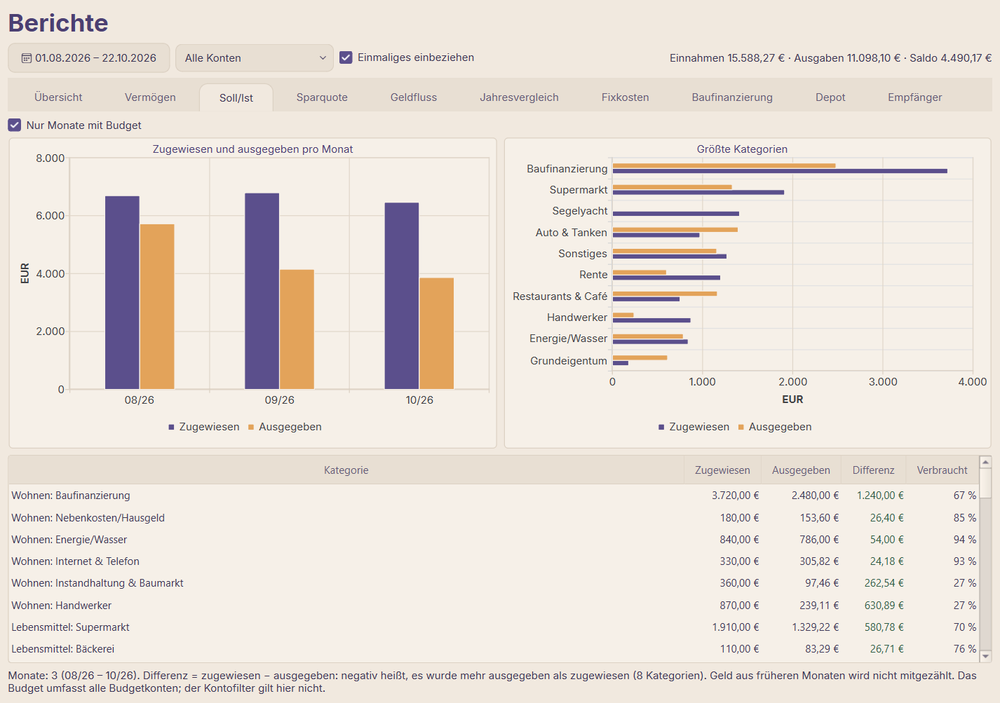

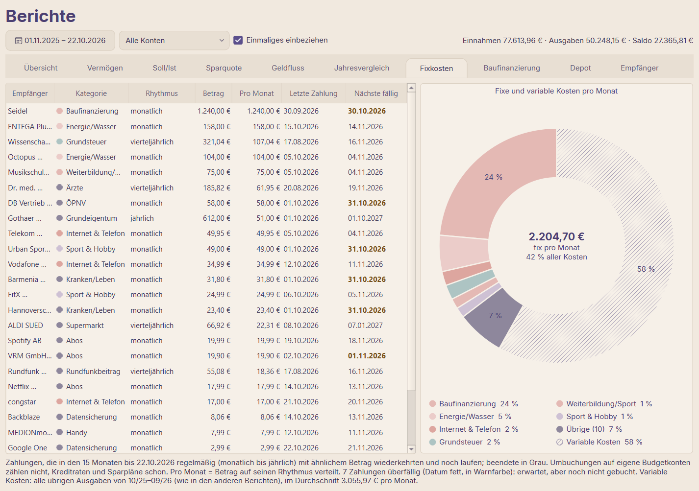

### Einmaliges und Berichtsmonat

Das Budget arbeitet mit dem Geld, wie es fließt (Buchungsdatum). Die Berichte zeigen, zu
welchem Monat Einnahmen und Ausgaben gehören:

- **Einmaliges**: „Einmaliges einbeziehen“ oben schaltet alle Berichte zwischen dem
  vollständigen Ergebnis und dem laufenden Haushalt um. Ohne Einmaliges lassen sich Monate
  vergleichen und die monatliche Sparquote lesen; mit Einmaligem für ein Jahr oder die
  12-Monats-Quote. Einmalige Kategorien sind in den Tabellen mit „(einmalig)“ markiert, und
  die Hinweise nennen, wie viel enthalten oder weggelassen ist. Die Tabelle der Sparquote
  bekommt eine Spalte „Einmalig“, wenn es im Zeitraum Einmaliges gibt.
- **Berichtsmonat**: Eine Zahlung, die zum Monatsende fällig ist, aber erst am 1. abgebucht
  wird (weil der 30./31. auf ein Wochenende fiel), zählt zu dem Monat, zu dem sie gehört:
  in „Kategorien & Regeln“ die Spalte „Berichtsmonat“ ihrer Kategorie doppelklicken, z. B.
  5 eintragen, dann „Kategorien speichern“. Buchungen am 1.–5. Tag zählen dann zum Vormonat
  (in der Datei: `report_shift_days: 5`). Die Hinweise der Berichte nennen diese Kategorien.

### Bis zu den Buchungen

- Budget: Doppelklick auf „Aktivität“ → die Buchungen dieser Kategorie und dieses Monats.
- Berichte: Doppelklick auf eine Zahl in einer Tabelle (Einnahmen, Ausgaben, Gespart,
  Ausgegeben, eine Kategorie in einem Jahr), auf einen Balken im Diagramm oder einen Knoten
  des Geldflusses → eine Aufschlüsselung, die genau diese Zahl ergibt: Kategorien mit ihren
  Buchungen, Buchungen, die zu einem anderen Monat zählen, mit „→ Monat“ markiert, und was
  nicht enthalten ist (Einmaliges). Doppelklick auf eine Buchung oder „Buchung zeigen“ öffnet sie auf der Seite
  Buchungen.

  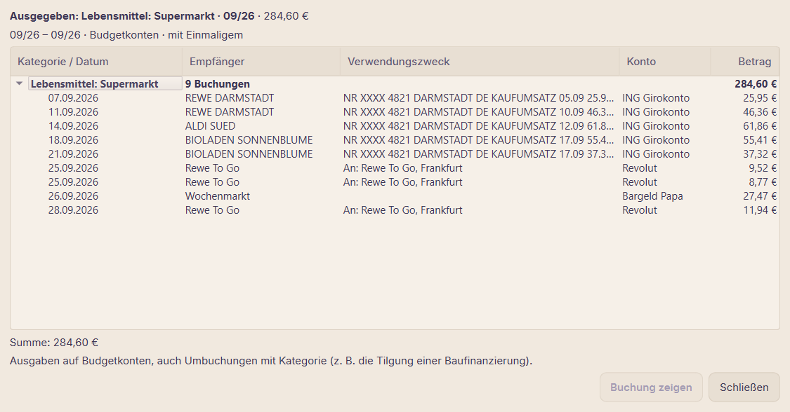
- Berichte → Empfänger: Doppelklick auf einen Empfänger.
- `Strg+K`: Empfänger oder Stichwort eintippen → „Alle N Buchungen mit „…“ anzeigen“.
- Beträge: „17,99“ findet ±17,99 €, „-17,99“ nur diese Ausgabe, „17“ 17,00 bis 17,99 €,
  „100..200“ einen Bereich, „>500“ / „<50“ größere / kleinere Beträge (in beiden Suchen).
- „Buchungen“: Suchfeld (Empfänger, Verwendungszweck, Notizen, Betrag), Filter für Zeitraum, Konto
  und Kategorie (eine Gruppe im Kategoriefilter, z. B. „Wohnen“, zeigt alle ihre
  Kategorien); die Zeile unten summiert die angezeigten Buchungen (Eingang / Ausgang).
  „Datei → Exportieren → Buchungen (aktueller Filter)…“ exportiert genau das Angezeigte.
  Mit einem Konto im Filter zeigt die Spalte „Saldo“ den Kontostand nach jeder Buchung, wie
  auf dem Kontoauszug: zum Abgleich und um eine fehlende Buchung zu finden. „Konten“ zeigt
  unter der Liste den Saldoverlauf des gewählten Kontos (12 Monate; Doppelklick: seine
  Buchungen).

### Jahresrückblick (Januar)

1. Alle Kontoauszüge des Jahres importiert, nichts unkategorisiert (Schritt 1).
2. Jahresvergleich und Soll/Ist für das ganze Jahr: Welche Kategorien sind gewachsen,
   welche Budgets waren unrealistisch?
3. Sparquote über 12 Monate und Vermögen: Haben sich Ersparnisse und Vermögen wie geplant
   entwickelt?
4. Fixkosten: Verträge und Abos, die gekündigt oder neu verhandelt werden sollten.
5. Baufinanzierung und Depot: Restschuld, Sondertilgung, Geldanlage.
6. Ziele für das neue Jahr: jährliche Kosten, Urlaub, große Anschaffungen („Betrag bis
   Datum“).

---

## 6. Pflege

- **Sicherungen**: automatisch vor jedem Import (die neuesten 10 bleiben); von Hand
  „Datei → Sicherung erstellen“; „Datei → Sicherungsordner öffnen“. Wiederherstellen:
  „Datei → Sicherung wiederherstellen…“ (Datum, Anlass, Anzahl Buchungen, Größe; vorher wird
  der aktuelle Stand gesichert, danach startet die App neu). Der Datenordner bleibt, wo er ist.
- **Datenordner in der Cloud oder auf einem NAS**: „Einstellungen → Datenordner…“ →
  „Ändern…“ kopiert Datenbank, Klassifikator, Sicherungen und Ansichtseinstellungen in einen
  anderen Ordner (z. B. in OneDrive), prüft die Kopien und startet die App darauf neu; die
  alten Dateien lassen sich dabei löschen. Ein Ordner, der schon eine Datenbank enthält
  (zweiter PC, Wiederherstellung), wird stattdessen geöffnet. Ist der Ordner beim Start nicht
  erreichbar (Cloud offline), fragt die App: erneut versuchen, anderen Ordner wählen oder
  beenden. Die Konfiguration bleibt in `config/`.
- **Regeln geändert oder viele Buchungen korrigiert**: „Werkzeuge → Kategorisierung neu
  ausführen“ wendet die Regeln erneut an (manuelle Zuordnungen bleiben); „Werkzeuge →
  Klassifikator neu trainieren“ trainiert die Vorschläge neu.
- **YAML von Hand geändert**: „Werkzeuge → Konfigurationsdateien neu laden“.
- **Depotbestände**: „Konten“ → das Depot wählen → „Bestände…“.

---

## Checkliste für jeden Monat

1. Kontoauszüge des Vormonats herunterladen → importieren (1.2), alle mit Saldo ✓, keine
   fehlenden Auszüge.
2. Vorschläge bestätigt, Unkategorisiertes zugeordnet, Regeln angelegt (1.3).
3. Vormonat: Überziehungen ausgeglichen, Abweichungen verstanden, Soll/Ist geprüft (3).
4. Neuer Monat: Ausgangspunkt, besondere Kosten, Ziele, „Zum Zuweisen“ = 0 (4).
5. Übersicht: alles im grünen Bereich; ein Blick auf Sparquote und Vermögen (5).
