# Working with the app: workflows

*Deutsch: [workflows.de.md](workflows.de.md)*

How to use the Hiro Budget month by month: import statements, tidy up the
bookings, create the first budget, review the past month, plan the next one, and analyse
where the money goes. Labels are quoted as the app shows them with the language set to
English ("Settings → Language").

The budget follows the YNAB principles: **give every euro a job** ("Ready to Assign" goes
to 0), **plan for true expenses** (targets for yearly and irregular costs), **roll with the
punches** (cover overspending by moving money), **age your money** (spend last month's
income).

Pages (sidebar, `Ctrl+1` … `Ctrl+6`): **Overview**, **Budget**, **Bookings**,
**Accounts**, **Reports**, **Categories & Rules**. `Ctrl+K` searches pages, commands,
accounts and bookings; `F1` lists all keyboard shortcuts. This guide is also in the app:
"Help → User guide".

---

## 0. Once: set up

1. **Accounts**: each own account with its IBAN (depot: the depot number), so imports land
   on the right account. For transfers between own accounts, "Recognize transfers to this
   account" (patterns on counterparty or purpose, e.g. "VISA REVOLUT" for Revolut top-ups
   from the current account) makes them transfers instead of expenses. Cash: "New
   account", kind cash, opening balance. "Budget: Money is assigned to categories" decides
   which accounts the budget plans with (current, savings and cash accounts by default;
   depot and loan only track a balance).
   Order: drag an account up or down, or ↑ / ↓ (Alt+↑ / Alt+↓), then "Save accounts"; the
   sidebar shows the same order. Clicking a column header only sorts the view (click again:
   descending, a third time: back to your order).

   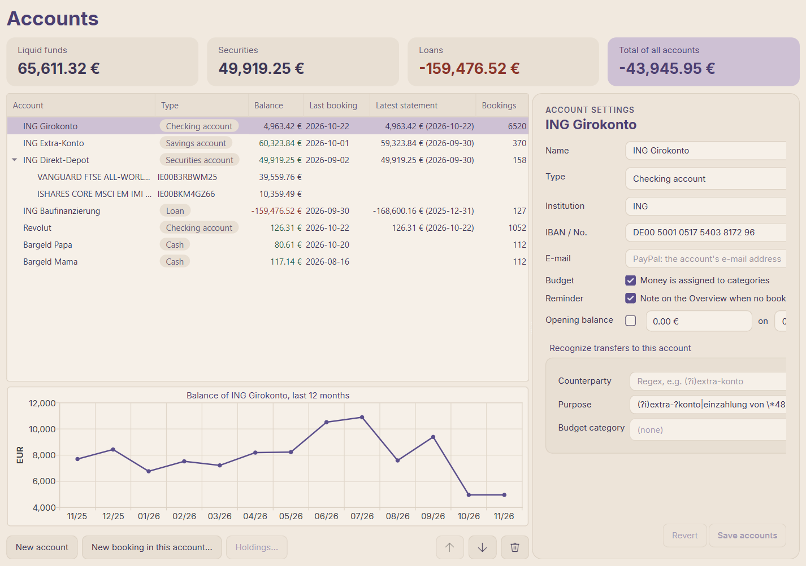
2. **Categories** ("Categories & Rules"): groups and categories as you want to budget them.
   Few and meaningful is better than many. Tick "One-off" for irregular income and expenses
   (bonus, tax refund, repairs) that the reports should be able to leave out; see
   "One-offs and the reporting month" in 5.
3. **Rules** (same page): recurring payees → category, first match wins. Most rules come
   later, quickly, from the bookings themselves (see 1.3). The fields take regular
   expressions; the "?" in each field (or `F1` there, or "Help → Regex cheat sheet…") shows
   the syntax and examples such as `(?i)rewe|edeka|aldi`. The number after each rule says
   how many bookings it categorizes; grey = none (obsolete, or a rule above takes every
   match). The search field above the list filters by id, category and pattern; "Show
   bookings" under a rule shows its matches.

   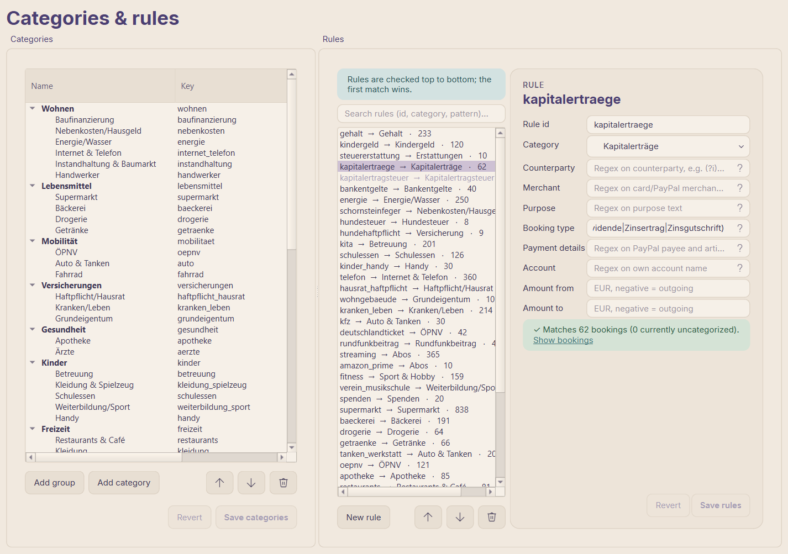
4. **Import folder**: `import_folder` in `config/config.yaml` (default `input/`). New PDFs
   and CSVs there make a dot appear on "Import" in the title bar.
5. **Budget start** (optional): `budget.start_month`; by default the first month with
   bookings. Everything before it counts as starting balance.
6. **PayPal** (optional): "New account", kind "Payment service (PayPal)", "E-mail" = the
   address of the PayPal account, "Save accounts". One account per PayPal account.

---

## 1. Import statements (after each month, or whenever new statements are there)

### 1.1 Get the files

| Source | What to download | How often |
|---|---|---|
| ING current account, Extra-Konto | Kontoauszug PDF (statement, from the Postbox) | monthly |
| ING, current month | Umsatzanzeige PDF (booking list, Umsätze → PDF) — for bookings before the statement exists | when needed |
| Revolut | statement PDF, EUR, in German, or statement CSV in English (any period; overlaps are fine, also between PDF and CSV) | monthly |
| ING Direkt-Depot | Depotauszug PDF (holdings and values) | quarterly / when issued |
| ING Baufinanzierung | yearly loan statement (sets the loan balance) | yearly |
| ING, any period | Umsatzanzeige as CSV (Umsätze → CSV) — same bookings as the PDF, either one | when needed |
| PayPal | activity download as CSV, all transactions (any period; overlaps are fine) | monthly |

Put them into the import folder (or anywhere).

### 1.2 Import

1. "Import" in the title bar (dot = new files in the import folder) or `Ctrl+I`. The new
   files of the import folder are already listed; more via "Add files…" / "Add folder…".
2. Check the list before importing:
   - **Balance ✓**: opening balance + bookings = closing balance. A missing ✓ means the
     file did not parse correctly: do not import it.
   - **Status**: "ready"; "nothing new" / "already imported" (skipped); "statements
     missing, see below" (a statement between the last import and this one is missing —
     import it too, otherwise the balance is wrong); "overlaps … stored bookings – you will
     be asked" (see below).
   - The lower table previews the bookings of the selected file with the category they
     will get ("Category (preview)"). "new, replaces manual booking" means a booking you
     entered by hand is replaced by the imported one (category and note are kept).

   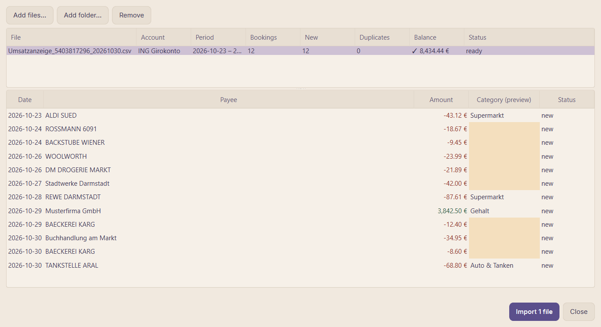
3. "Import N file(s)". Before the import a backup of the database and configuration is
   made automatically. Afterwards the classifier learns from the categorized bookings
   ("Classifier is learning from the categorized bookings…", 1–3 s).
4. **Overlapping statements** (e.g. the statement after a booking list of the same month):
   "Add missing" imports only bookings not stored yet; "Overwrite" replaces the period with
   the file (choose this when the statement follows a booking list; categories and notes of
   identical bookings are kept).

Something went wrong? "File → Import history…" lists every import; deleting one removes its
bookings, and the file can be imported again.

### 1.2b Fetch from the bank instead (FinTS)

Accounts with online banking (ING) can be fetched instead of downloading statements.

1. **Once:** "Settings → Bank access…". Enter the login ID (bank code and server of ING are
   filled in), "Test connection…" (asks for the PIN) lists the accounts of the login. For
   each one choose the **app account** (an existing one with the same IBAN is preselected,
   otherwise "New: …") and check **"Fetch from"**: bookings from this day on come from the
   bank, statements cover the days before. It is preset to the day after the account's last
   imported statement; "as far back as possible" for new accounts (their starting balance
   is then taken from the bank). "Save". The PIN is not saved.
2. **Every time:** "Fetch" in the title bar (or "File → Fetch from bank"), enter the PIN.
   The status next to the button shows "Fetching from ING…", "Please confirm in the ING
   app" with "Cancel" when the bank wants a confirmation, and at the end "✓ N new bookings
   · balances match". "⚠ … balance differs": click the status for the details (bank balance
   vs. app balance per account).
3. New bookings are categorized like imported ones. Each fetch appears in "File → Import
   history…" (one entry per account with new bookings) and can be deleted there; the next
   fetch gets those bookings again.
4. Statements of a fetched account can still be imported: bookings on days already fetched
   are left out ("… per FinTS" in the import list), all others are imported. A later fetch
   replaces statement bookings it delivers itself (category and note are kept).

Securities accounts are listed, but their holdings are not fetched yet.

### 1.2c CSV exports and PayPal

CSV files are imported like PDFs. Which columns mean what is described per bank in a format
(included: the ING Umsatzanzeige, Revolut and PayPal); a format for another bank's export is
a small plugin in `config/plugins/`, see [csv-import.en.md](csv-import.en.md).

PayPal: most payments are paid from the current account (debit card or direct debit), so
the current account already has them as "VISA PAYPAL *…" or "PayPal Europe". These are not
imported a second time: the current account booking stays the expense and gets the PayPal
payee and article ("Payment details" in the booking details; rules can match them, field
"Payment details"). The import list shows them as "N payments via bank". Only what does not
touch the current account becomes a booking of the PayPal account: payments from the PayPal
balance, money received or sent.

The current account books a PayPal payment a few days later. If it is not imported yet, the
payment waits and is linked after the next import or fetch; the import message says how
many are waiting (and how many for more than 30 days: those probably came from another
account).

### 1.3 Tidy up the new bookings

Goal: every booking has a category. The Overview shows what is left ("bookings without a
category", "suggestion(s) to review"); the Budget page warns with a banner ("Categorize
them").

1. **Suggestions of the classifier**: "Bookings" → "? Suggestions to review". Correct
   wrong ones (`Enter`/`F2` on the row, or the category field in the card on the right),
   then "Accept selected" or "Accept all shown (N)". Accepted suggestions count as manual
   and improve the classifier.

   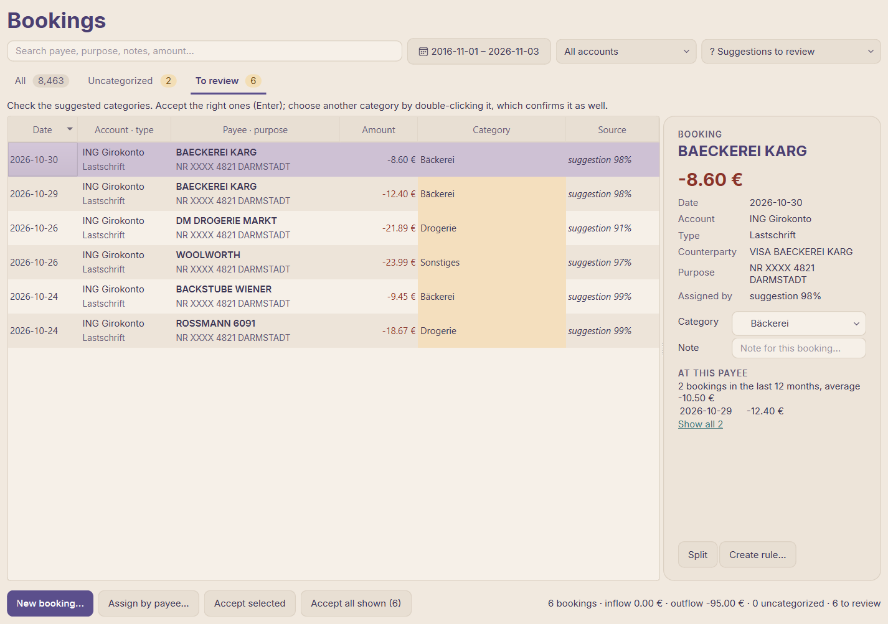
2. **Uncategorized, by payee**: "⚠ Uncategorized" → "Assign by payee…". One payee at a time
   with all its bookings; choose the category, tick "Create a rule: future bookings of …
   get this category" so future bookings are categorized automatically, "Assign". This
   clears most of the list quickly.

   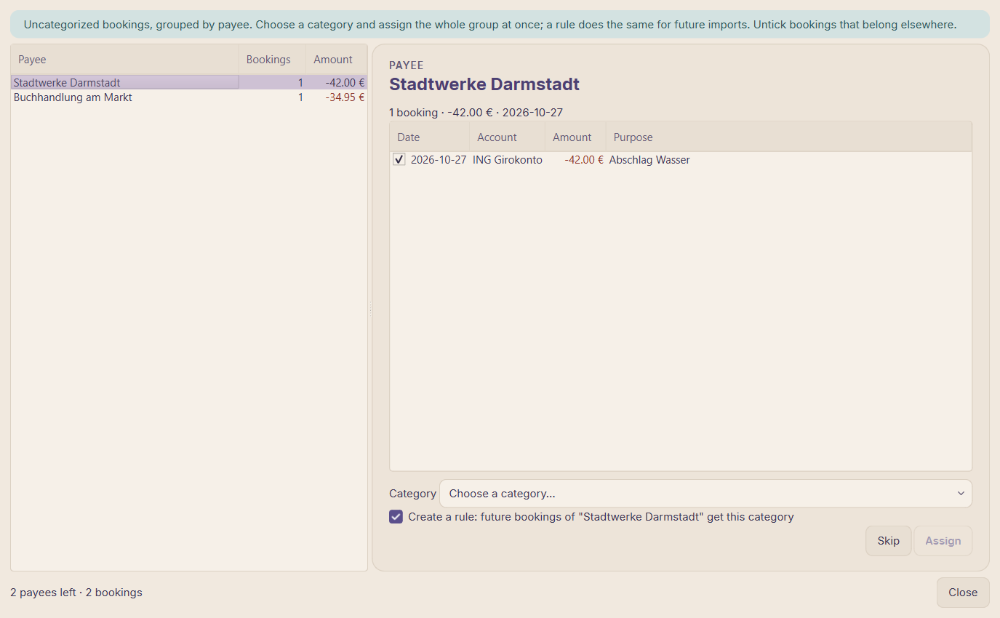
3. **The rest by hand**: select a booking, `Enter`/`F2` or double-click its category: a
   menu with one submenu per group (the current category is ticked); or the card on the
   right.
   - One payment for several things (supermarket + drugstore, a mixed online order):
     "Split" in the card on the right (or `Ctrl+D`, or right-click → "Split…"): one row
     per part with category or transfer, amount and memo; "Remaining" must be 0.00, then
     "Save split". A split booking shows its parts there and they stay editable; down to
     one part it is an ordinary booking again.

     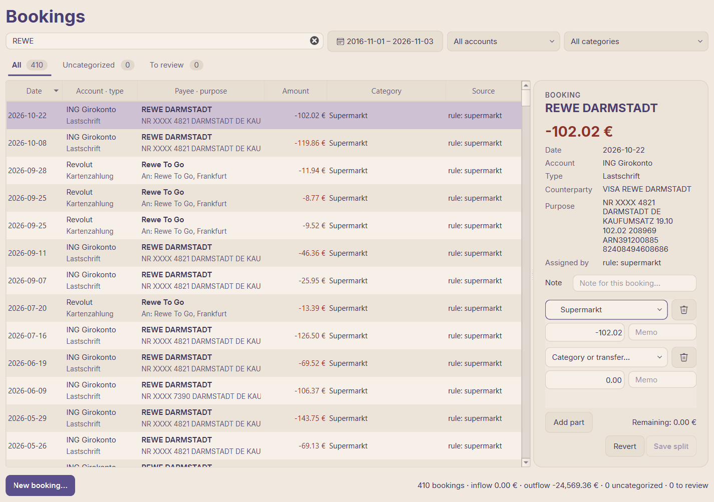
   - Recurring payee without a rule yet: right-click → "Create rule from this booking…";
     the rule editor shows how many bookings the rule would match.
   - Context worth remembering ("present for grandma", "refund follows"): "Note" in the
     card; notes are searchable.
   - Is that a lot? "At this payee" in the card: count and average of the last 12 months,
     the last bookings, "Amount changed: before …" at a new amount, "Show all N".
4. **Cash and other manual bookings**: "New booking…" (`Ctrl+N`) — expense, income or
   transfer on any account (e.g. withdrawn cash spent at the market). A transfer to another
   own account creates the counter-booking there.
5. Done when "Uncategorized" and "To review" show 0.

---

## 2. Create the first budget

Prerequisite: a few months of history are imported (3–6 months give good proposals; the
proposal dialog warns when history is thin) and the bookings are categorized (step 1.3).

1. **Budget** page, the current month ("Today"). At the top: "Ready to Assign" — the money
   on the budget accounts that has no job yet.

   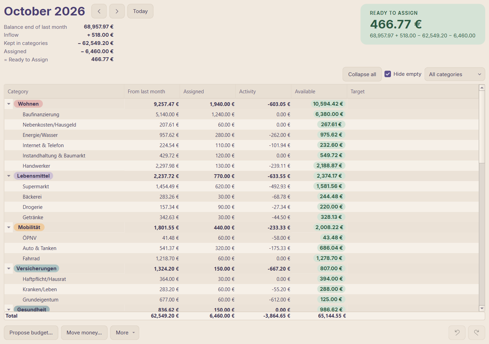
2. **"Propose budget…"**: proposes an amount per category from past spending.
   - "regular" (spending in most months): the median of the last months, so one-off
     purchases don't inflate it.
   - "irregular (provision)": insurance, gifts, repairs — the total of the last 12 months
     spread as a monthly provision.
   - Click Min / Median / Max to take another value; untick categories you want to set
     yourself; "Only empty categories" keeps what you already assigned. The footer shows
     what is left to assign afterwards. "Apply selected".

   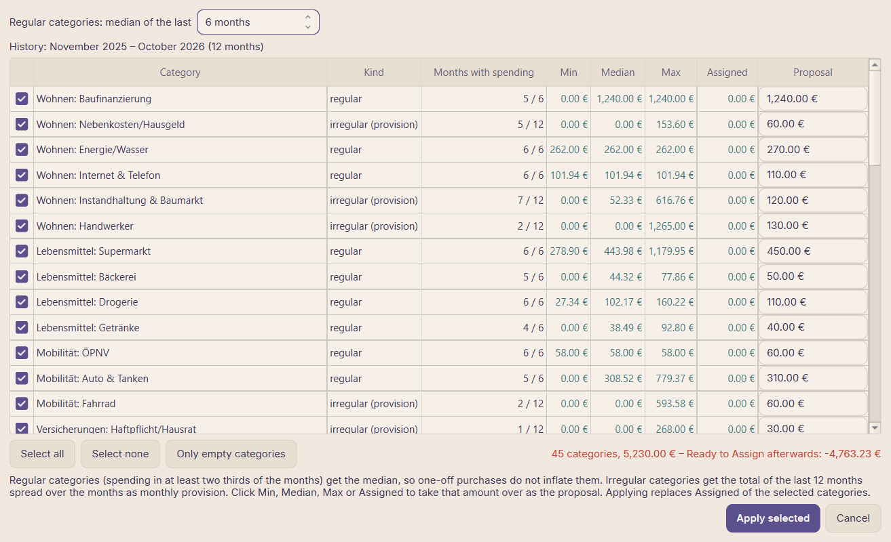
3. **Adjust** per category in "Assigned": double-click or `Enter`, then type `600`, `+50`,
   `-20` or `=0`. Everything can be undone (`Ctrl+Z` / `Ctrl+Y`).
4. **Targets** for true expenses ("Target" column, double-click):
   - "Monthly amount": e.g. pocket money, a savings plan
   - "Amount by date": e.g. holiday 2,400 € by July; the app computes the monthly amount
   - "Repeating (e.g. yearly)": car insurance every 12 months, due in January
   - "Savings balance": an emergency fund to reach, without a deadline

   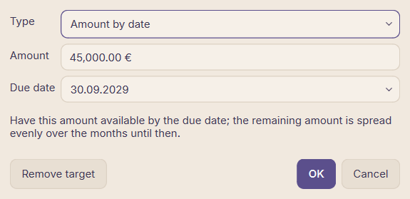

   Then "More ▾ → Assign to targets" funds what the targets need this month, as far as the
   money goes. Yellow "Available" = target not yet funded. The bar under each target shows
   how far along it is: green on track, amber while this month still needs money.
5. **Bring "Ready to Assign" to 0**: positive — give the rest a job (savings goal, buffer,
   next big expense); negative — you assigned more than you have, take money back from
   categories ("Assigned too much - remove from categories").
6. Optional: a group whose categories may share money (e.g. leisure): right-click the group
   → "Budget this group as a whole".

The rule behind it: balance of all budget accounts = Ready to Assign + sum of "Available".
The summary under the month shows how "Ready to Assign" comes about: "Balance end of last
month" + "Inflow" − "Kept in categories" (what the categories brought over from last month)
− "Assigned".

---

## 3. Review the past month (early in the new month)

Do step 1 first, so all bookings of the month are in and categorized.

1. **Budget** → previous month (`Alt+Page Up` or the arrow next to the month).
2. **Overspent** categories (red "Available"): overspending is not carried over; it is
   taken from the next month's "Ready to Assign". Cover it now:
   - select the red row → "Move money…" (`Ctrl+M`) from a category with money left, or
   - "More ▾ → Cover overspending" covers all of them from "Ready to Assign" as far as
     possible.

   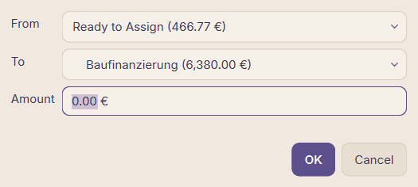
3. **Understand the differences**: double-click "Activity" of a category to see its bookings
   of the month. Wrong category? Fix it there (it moves to the right envelope). An
   unexpected one-off? Note it; maybe it needs a target from now on.
4. **Budget vs. actual** ("Reports → Budget vs. actual", period = that month or the last
   months): assigned vs. spent per category. Categories that are always over or always far
   under are the ones to correct in the next budget.
5. **Left-over money** stays in its category ("From last month" in the next month); that is
   the point of provisions. For categories that should start fresh each month, move the
   rest with "Move money…" to a savings goal or back to "Ready to Assign".
6. **Adjust the plan**: change amounts or targets that turned out wrong (steps 2.3 / 2.4).
   Changing assignments of a past month is allowed; it changes what was carried over.

---

## 4. Budget for the upcoming month

Best done when the salary has arrived (income flows into "Ready to Assign" of the month it
is booked in), or in advance with the money already there.

1. **Budget** → next month (`Alt+Page Down`).
2. A starting point, one of:
   - "More ▾ → Copy last month": last month's amounts into empty categories (stable months)
   - "Propose budget…": fresh proposals from the history (after changes in life: new job,
     child care, new car)
   - then "More ▾ → Assign to targets" for the targets.
3. **Special things of this month**: birthdays, holidays, school start, yearly insurance.
   The Overview lists "Due soon" (fixed costs due in the next 30 days) and "Reports → Fixed
   costs" all recurring payments with their months; make sure their categories have
   enough.
4. **"Ready to Assign" to 0** as in step 2.5. "Assigned in later months" in the summary
   shows money already given to later months (planning ahead is fine; it is subtracted
   from "Ready to Assign").
5. During the month: spending shows up as "Activity" after each import. When a category runs
   out, move money in from another one before (or right after) overspending: "Move
   money…".

---

## 5. Analysis

### Monthly quick look: Overview

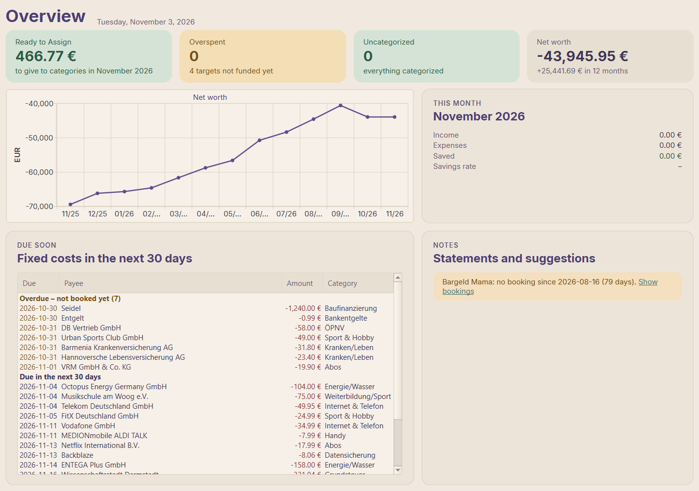

| Card / section | Question | Next step |
|---|---|---|
| Ready to Assign | Does every euro have a job? | click → Budget |
| Overspent | Which categories ran over? | click → Budget, cover them (3.2) |
| Uncategorized / suggestions | Is everything categorized? | click → Bookings (1.3) |
| Net worth | How did net worth develop in 12 months? | click → Reports → Net worth |
| This month | Income, expenses, saved, savings rate so far | — |
| Due soon | Which fixed costs come in the next 30 days? | check their budget categories |
| Notes | Missing statements, accounts without a booking for weeks (count the cash?), suggestions to check | import the missing statements; turn the reminder off per account under "Accounts" |

### Reports

Choose the **period** (button with presets: This month, Last month, This year, Last year,
Last 12 months, Everything, or your own dates) and the **account** at the top; all tabs
follow it. "File → Export → Report (current period)…" saves it to Excel/CSV.

| Tab | Question it answers | Typical use |
|---|---|---|
| Overview | Income vs. expenses per month; below it each month's expenses as fixed and variable costs; expenses by group as a donut (a click on a group shows its categories, "← All groups" goes back; double-click a category: its bookings); how one category develops (category trend) | monthly; pick a category to see its trend |
| Net worth | Net worth at each month end: accounts, depot, minus the loan | quarterly / yearly |
| Budget vs. actual | Assigned vs. spent per category and month | after each month (3.4); plan corrections |
| Savings rate | (income − expenses) / income per month and over 12 months | monthly trend, yearly target |
| Cash flow | Where the money goes: income categories → income groups → expense groups → expense categories (Sankey), with the wealth building (surplus) or what came from reserves; expense groups in their budget colours; categories under 1 % combined per group; double-click a node for its bookings | yearly review; the whole period at a glance |
| Year comparison | Expenses per category this year vs. last year (January up to the same month) | yearly review, spotting creeping costs |
| Fixed costs | Detected recurring payments (subscriptions, contracts, instalments) with cost per month; ended ones grey; donut of fixed costs against the average variable costs of the last 12 months | twice a year: cancel what you don't use |
| Mortgage | Remaining debt, interest, repayment, special repayments per year; a forecast (dashed) from the latest instalment: payoff date, interest until then, debt at the end of the fixed-rate period (`fixed_until` in `config.yaml`); "Special repayment per year" shows what a repayment every December brings | yearly; special repayment decisions |
| Depot | Value per security on each depot statement vs. money invested | after each depot statement |
| Payees | Largest payees; double-click shows the bookings | finding the big money sinks |

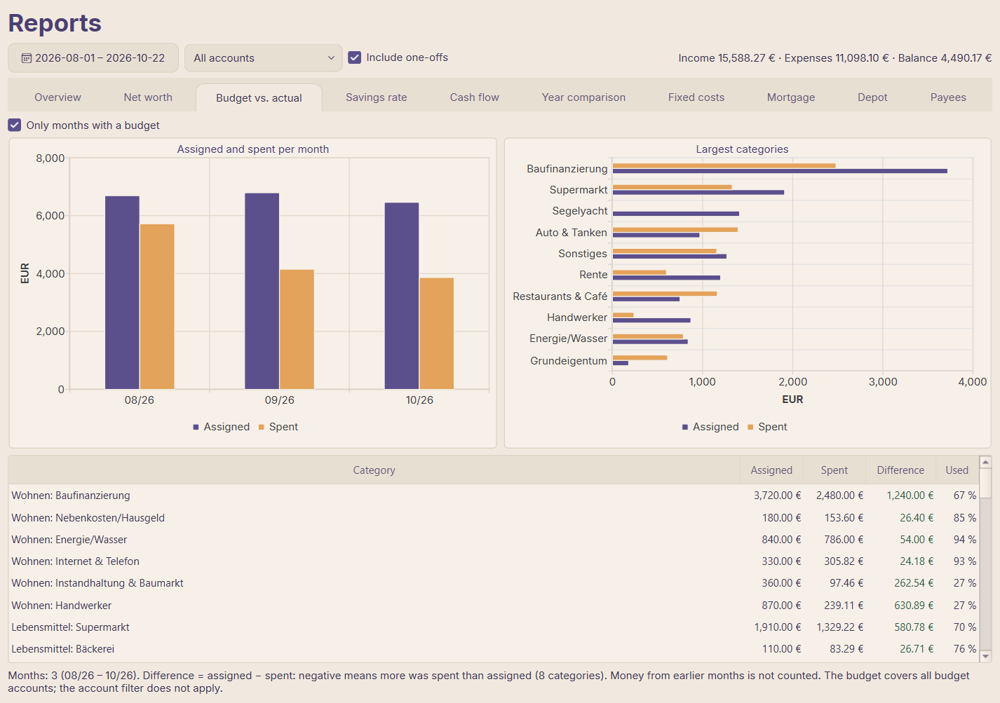

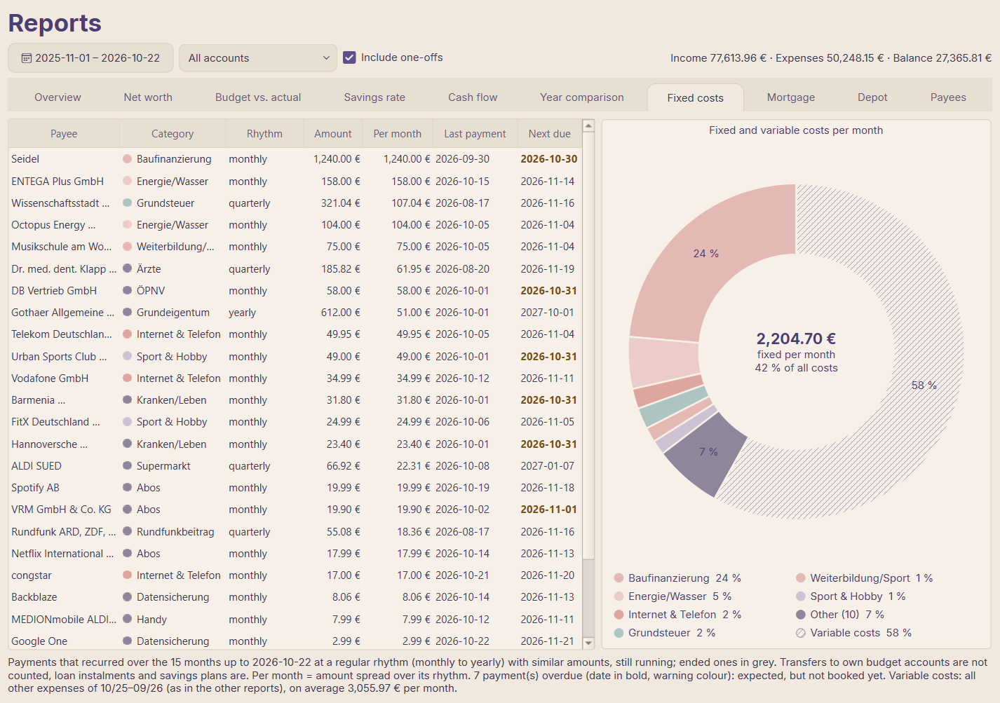

### One-offs and the reporting month

The budget works with the money as it moves (booking date). The reports show which month
income and expenses belong to:

- **One-offs**: "Include one-offs" at the top switches all reports between the complete
  result and the regular household. Leave them out to compare months and read the monthly
  savings rate; include them for a year or the 12-month rate. One-off categories are marked
  "(one-off)" in the tables, and the notes say how much was included or left out. The
  savings rate table gets a "One-offs" column when there are any in the period.
- **Reporting month**: a payment due at the end of a month but debited on the 1st (because
  the 30th/31st was a weekend) counts for the month it belongs to: in "Categories & Rules"
  double-click the column "Report month" of its category and enter e.g. 5, then "Save
  categories". Bookings on day 1–5 then count for the previous month (in the file:
  `report_shift_days: 5`). The notes of the reports name these categories.

### Drill down to the bookings

- Budget: double-click "Activity" → the bookings of that category and month.
- Reports: double-click a number in a table (income, expenses, saved, spent, a category in a
  year), a bar in a chart or a node of the cash flow → a breakdown that adds up to exactly that number: categories
  with their bookings, bookings counted for another month marked "→ month", and what was
  left out (one-offs). Double-click a booking or "Show booking" opens it on the bookings
  page.

  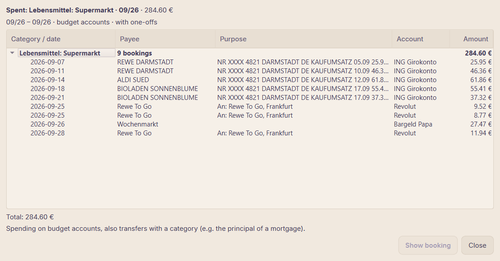
- Reports → Payees: double-click a payee.
- `Ctrl+K`: type a payee or word → "Show all N bookings with “…”".
- Amounts: "17,99" finds ±17,99 €, "-17,99" only that expense, "17" 17,00 to 17,99 €,
  "100..200" a range, ">500" / "<50" larger / smaller amounts (in both searches).
- "Bookings": search field (payee, purpose, notes, amount), period, account and category
  filters (a group in the category filter, e.g. "Wohnen", shows all its categories); the line at the bottom sums the shown bookings (inflow / outflow). "File →
  Export → Bookings (current filter)…" exports exactly what is shown. With one account in
  the filter, the "Balance" column shows the account balance after each booking, as on the
  statement: to compare and to find a missing booking. "Accounts" shows the selected
  account's balance over 12 months under the list (double-click: its bookings).

### Yearly review (January)

1. All statements of the year imported, nothing uncategorized (step 1).
2. Year comparison and Budget vs. actual for the whole year: which categories grew, which
   budgets were unrealistic.
3. Savings rate over 12 months and Net worth: did savings and net worth develop as planned?
4. Fixed costs: contracts and subscriptions to cancel or renegotiate.
5. Mortgage and Depot: remaining debt, special repayment, investments.
6. Targets for the new year: yearly costs, holiday, big purchases ("Amount by date").

---

## 6. Housekeeping

- **Backups**: automatic before each import (the newest 10 are kept); by hand "File →
  Create backup"; "File → Open backup folder". To restore: "File → Restore backup…" (date,
  reason, number of bookings, size; the current state is backed up first, then the app
  restarts). The data folder stays where it is.
- **Data folder in the cloud or on a NAS**: "Settings → Data folder…" → "Change…" copies the
  database, the classifier, the backups and the view settings to another folder (e.g. in
  OneDrive), checks the copies and restarts the app on it; the old files can be deleted on
  the way. A folder that already holds a database (a second PC, a restore) is opened
  instead. If the folder is not reachable at start (cloud offline), the app asks: retry,
  choose another folder, or quit. The configuration stays in `config/`.
- **Rules changed or many bookings corrected**: "Tools → Re-run categorization" applies the
  rules again (manual assignments are kept); "Tools → Retrain classifier" retrains the
  suggestions.
- **YAML edited by hand**: "Tools → Reload configuration files".
- **Depot holdings**: "Accounts" → select the depot → "Holdings…".

---

## Monthly checklist

1. Download the statements of the past month → import (1.2), all with Balance ✓, no
   missing statements.
2. Suggestions accepted, uncategorized assigned, rules created (1.3).
3. Past month: overspending covered, differences understood, Budget vs. actual checked (3).
4. New month: starting point, special costs, targets, "Ready to Assign" = 0 (4).
5. Overview: everything green; a look at Savings rate and Net worth (5).
